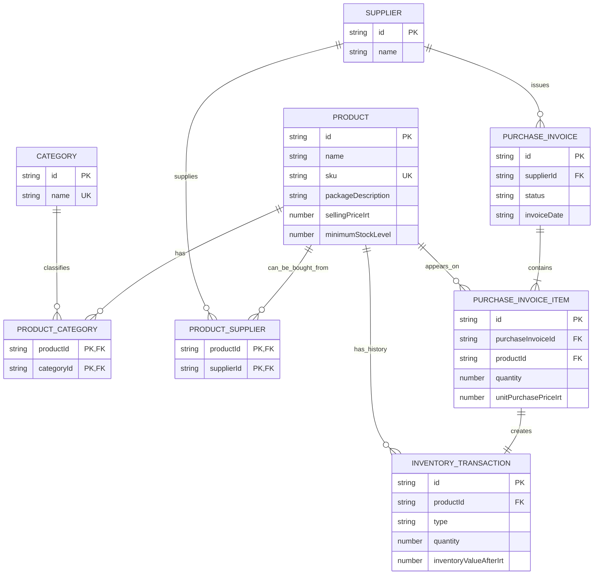

# Storix — Business Rules & Data Model

**Document:** Business Rules & Data Model  
**Version:** 1.3  
**Status:** Finalized specification for MVP review  
**Last Updated:** 2026-11-11  
**Primary Reference:** [`PRD.md`](./PRD.md)  
**Related Reference:** [`UI_UX_SPECIFICATION.md`](./UI_UX_SPECIFICATION.md)

---

## 1. Purpose

This document defines the business rules and conceptual data model for the Storix MVP. It is the source of truth for product relationships, count-based stock, supplier purchase invoices, purchase-price history, selling prices, inventory valuation, stock movements, and sales analytics data.

The document is intended to guide product requirements, UI/UX design, and later frontend implementation. It does not define the final frontend architecture, component structure, routing library, state-management library, or backend services.

## 2. Product Scope and Constraints

Storix is a general-purpose inventory management application with read-only sales analytics.

| Area | MVP rule |
|---|---|
| Product domain | General-purpose product and inventory management. Do not require an industry-specific workflow. |
| Warehouse | One warehouse. No warehouse selection or transfer workflow. |
| User context | One local user context. No authentication, roles, or permissions. |
| Backend | No backend or external business integration in the MVP. |
| Editable data | Stored in browser LocalStorage. |
| Sales analytics | Read-only sample data. It is separate from editable inventory data. |
| Currency | `IRT`, displayed as `تومان`. All stored money values are integer tomans. |
| Stock quantity | Whole-number count of sellable or stockable product units. Display each quantity with the count label `عدد`. Show package description as separate context. |
| Purchase prices | Entered manually from supplier invoices. No live online price feed. |
| Selling price | A current product-level selling price, separate from purchase prices. |
| Purchase invoices | Basic supplier invoice capture to record received quantities and actual acquisition prices. This is not a full procurement or accounting module. |
| Real sales | Out of scope. No sales orders, customer management, customer records, sales invoices, payments, or sale-driven stock deduction. |

The MVP must not imply that LocalStorage data is synchronized between browsers, devices, or users. A future backend may replace the local persistence layer, but backend behavior is not part of this specification.

## 3. Product-Owner Decisions

The following decisions were explicitly supplied by the product owner.

| ID | Decision | Rule |
|---|---|---|
| A-01 | Currency | Use `IRT`, displayed as تومان. Store money as integer toman amounts. |
| A-02 | Product-category relationship | Many-to-many. A product can belong to multiple categories. |
| A-03 | Product-supplier relationship | Many-to-many. A product can have multiple suppliers. |
| A-04 | Stock unit | Count products or packages as whole items. |
| A-05 | Fractional stock | Not supported. Stock quantities are whole numbers only. |
| A-06 | Package contents | Package contents are descriptive. They do not change the stock count. |
| A-07 | Price support | Keep purchase-price and selling-price information separate. Both are needed for future reports. |
| A-08 | Purchase-price source | Purchase prices are entered from supplier invoices. They do not update online. |
| A-09 | Latest purchase price | Show the latest purchase price for each product-supplier pair, with invoice date and relative age. |
| A-10 | Purchase invoice capture | A supplier purchase invoice creates the incoming stock record and preserves the price history. |

Examples:

- `Rice — 5 kg bag`: 25 bags means stock quantity `25`, not `125 kg`.
- `Cooking oil — 1.5 L bottle`: 48 bottles means stock quantity `48`, not `72 L`.
- `Keyboard`: 12 keyboards means stock quantity `12`.

If two package sizes must have separate stock or prices, create two separate Product records with separate SKUs.

## 4. Final MVP Decisions

The following seven rules close the seven unresolved rule items from the previous version. They are specification decisions for review. They must not be described as directly approved by the product owner until the documentation review is complete.

| ID | Topic | Final MVP rule |
|---|---|---|
| D-01 | Inventory valuation | Use Moving Weighted Average Cost (MWAC). |
| D-02 | Minimum stock default | Default to `0`; allow a whole-number threshold per product. |
| D-03 | Zero selling price | Allow `0` for an intentionally free product. Use `null` when no selling price is set. |
| D-04 | Opening stock cost | Require a known acquisition cost per unit when opening quantity is greater than zero. The supplier is optional if it is unknown. |
| D-05 | Invoice price basis | Enter the net merchandise unit price after any item-level discount and before tax. Do not allocate invoice-wide discounts, tax, shipping, freight, or other fees in the MVP. |
| D-06 | Stock OUT reasons | Require `DAMAGE`, `INTERNAL_USE`, `ADJUSTMENT`, or `OTHER`. `SALE` is not available. `OTHER` and `ADJUSTMENT` require a note. |
| D-07 | Purchase invoice correction | Posted invoices are immutable. An invoice can be voided only when every affected product has no later inventory movement after that invoice's Stock IN transaction. Voiding creates compensating transactions and excludes the invoice from latest-price calculations. |

### 4.1. D-01 — Moving Weighted Average Cost

Use a moving average cost for each product. Do not track individual stock batches or FIFO layers in the MVP.

The method updates the average acquisition cost after each valid opening balance or purchase receipt. A Stock OUT removes inventory value at the current average cost.

### 4.2. D-02 — Minimum Stock Threshold

A new product has a minimum stock threshold of `0`. The user can set a non-negative whole-number threshold for each product.

A product is Low Stock when `currentStock <= minimumStockLevel`. Therefore, a product with zero stock is included in the Low Stock count when its threshold is zero. The more specific `Out of Stock` label must still be shown.

### 4.3. D-03 — Selling Price

`sellingPriceIrt = null` means that the user has not set a selling price. `sellingPriceIrt = 0` means that the product is intentionally free. A positive value is the current expected/list selling price for one stock unit.

The Product form must not silently convert an empty field to zero.

### 4.4. D-04 — Opening Stock Cost

If opening quantity is greater than zero, the user must enter the known acquisition cost per unit. This is required to calculate inventory value. The user may select a linked supplier when known, but a supplier is not mandatory for opening stock.

An opening balance is not a supplier purchase invoice. Do not create a PurchaseInvoice for opening stock.

### 4.5. D-05 — Purchase Invoice Price Basis

The unit purchase price stored on each invoice line is the net merchandise price per unit, after any discount applied directly to that line and before tax.

The MVP does not calculate or allocate:

- Invoice-wide discounts that are not assigned to individual product lines.
- VAT or other taxes.
- Shipping, freight, delivery, or handling charges.
- Other invoice-wide charges.

The purchase invoice screen must label its calculated amount as `Items Subtotal`, not as a full payable invoice total. It must not show payment status, amount due, tax totals, or supplier balances.

### 4.6. D-06 — Stock OUT Reasons

Every Stock OUT operation requires one reason:

- `DAMAGE`: damaged or unusable stock.
- `INTERNAL_USE`: stock used by the business.
- `ADJUSTMENT`: a downward correction after a physical count. A note is mandatory.
- `OTHER`: any other non-sale stock removal. A note is mandatory.

The MVP does not support sales as a Stock OUT reason. The MVP also does not support a positive manual stock adjustment. Stock increases must come from an opening balance or a supplier purchase invoice.

### 4.7. D-07 — Purchase Invoice Void

A posted purchase invoice cannot be edited or deleted. It can be voided only when all of the following are true:

1. Every invoice item has a corresponding Stock IN transaction.
2. For every affected product, that Stock IN transaction is the latest inventory transaction for that product.
3. No later Stock IN, Stock OUT, opening, or purchase-void transaction exists for any affected product.
4. The invoice has not already been voided.
5. The user enters a mandatory void reason.

When the conditions pass, Storix must atomically:

1. Mark the invoice as `VOIDED` and store the void timestamp and reason.
2. Create one `PURCHASE_VOID` transaction for each invoice line.
3. Reverse the exact quantity and acquisition value introduced by the source Stock IN transaction.
4. Preserve the original invoice, invoice items, Stock IN transactions, and all reversal records.
5. Exclude the voided invoice from latest purchase price projections.

If a later inventory movement exists for any line product, invoice voiding is blocked. The UI must explain which product prevents the void. Arbitrary edits, partial invoice voids, and general-purpose invoice correction workflows are outside the MVP.

---

## 5. Domain Concepts

### 5.1. Product

A Product represents one distinct item or package that Storix counts as one stock unit. It has a unique SKU, product details, a minimum stock threshold, an optional current selling price, and many-to-many relationships with categories and suppliers.

A Product does not store a single purchase price. Purchase prices vary by supplier and invoice. The latest price is derived from valid purchase invoice history.

### 5.2. Category

A Category groups products for navigation and filtering. A Product can have zero, one, or many categories. A Category can be assigned to many Products.

### 5.3. Supplier

A Supplier stores supplier contact details. A Supplier can provide many Products, and a Product can be obtained from many Suppliers.

### 5.4. Product-Supplier Relationship

This junction record links a Product to a Supplier. It can store the supplier's product code. It must not store a purchase price. Actual prices come from supplier invoices.

### 5.5. Purchase Invoice

A Purchase Invoice records a supplier document used to receive stock. It belongs to one Supplier and contains one or more unique Product lines. It stores the invoice date, optional invoice number, optional note, recorded time, and status.

The invoice is a stock receipt and price-history record. It is not a purchase order, payment, accounts-payable record, or full accounting document.

### 5.6. Purchase Invoice Item

A Purchase Invoice Item represents one Product line on a supplier invoice. It stores a whole-number quantity and the effective unit purchase price from that invoice line.

Each saved item creates exactly one `STOCK_IN` transaction.

### 5.7. Inventory Transaction

An Inventory Transaction is an immutable stock-ledger entry for one Product. Supported types are:

- `OPENING_STOCK`
- `STOCK_IN`
- `STOCK_OUT`
- `PURCHASE_VOID`

A transaction stores before/after quantities and the price/cost snapshots needed to reproduce stock value. A transaction is not a sale unless a future, separately approved sales module is added.

### 5.8. Sales Mock Entry

A Sales Mock Entry is a static daily aggregate for one product key. It stores sample quantity sold, revenue, and cost of goods sold for Sales Analytics. It does not represent an individual order, customer, invoice, or payment.

---

## 6. Entity Relationships



`SalesMockEntry` and `AppSettings` are separate from the inventory relationship graph. Sales mock data does not create or change inventory transactions.

### 6.1. Relationship Rules

| Relationship | Cardinality | Rule |
|---|---|---|
| Product ↔ Category | Many-to-many | Use `ProductCategory` junction records. |
| Product ↔ Supplier | Many-to-many | Use `ProductSupplier` junction records. |
| Supplier → Purchase Invoice | One-to-many | Each invoice belongs to one supplier. |
| Purchase Invoice → Items | One-to-many | Each posted invoice has one or more items. |
| Product → Invoice Items | One-to-many | A product can appear on invoices over time. |
| Invoice Item → Stock IN | One-to-one | Each posted item creates exactly one Stock IN transaction. |
| Product → Inventory Transactions | One-to-many | A product has an immutable movement history. |
| Product-Category pair | Unique pair | Do not create duplicate assignments. |
| Product-Supplier pair | Unique pair | Do not create duplicate links. |
| Invoice-Product pair | Unique pair | A product can appear once per invoice in the MVP. |

---

## 7. Data Model

The fields below define the conceptual model. Final TypeScript file locations belong to Frontend Architecture.

### 7.1. Product

| Field | Type | Required | Rule |
|---|---|---:|---|
| `id` | `string` | Yes | Stable identifier. |
| `name` | `string` | Yes | Trimmed and non-empty. |
| `sku` | `string` | Yes | Required; unique after trimming and upper-case normalization. |
| `description` | `string` | No | Plain text. |
| `packageDescription` | `string \| null` | No | Example: `5 kg bag`; descriptive only. |
| `sellingPriceIrt` | `number \| null` | No | Null = not set; zero = free; otherwise non-negative safe integer tomans. |
| `stockUnitCode` | `"unit"` | Yes | Fixed. Display the count with `عدد`; show package description separately. |
| `minimumStockLevel` | `number` | Yes | Non-negative safe integer; default `0`. |
| `archivedAt` | `string \| null` | No | Null while active. Used to retain history after removal from active catalog. |
| `createdAt` | `string` | Yes | ISO 8601 timestamp. |
| `updatedAt` | `string` | Yes | ISO 8601 timestamp. |

Current stock and current average cost are derived from the transaction ledger. Do not edit either value directly on Product.

### 7.2. Category

| Field | Type | Required | Rule |
|---|---|---:|---|
| `id` | `string` | Yes | Stable identifier. |
| `name` | `string` | Yes | Trimmed and unique without case sensitivity. |
| `description` | `string` | No | Plain text. |
| `createdAt` | `string` | Yes | ISO 8601 timestamp. |
| `updatedAt` | `string` | Yes | ISO 8601 timestamp. |

### 7.3. ProductCategory

| Field | Type | Required | Rule |
|---|---|---:|---|
| `productId` | `string` | Yes | Existing Product. |
| `categoryId` | `string` | Yes | Existing Category. |
| `assignedAt` | `string` | Yes | ISO 8601 timestamp. |

The `(productId, categoryId)` pair is unique.

### 7.4. Supplier

| Field | Type | Required | Rule |
|---|---|---:|---|
| `id` | `string` | Yes | Stable identifier. |
| `name` | `string` | Yes | Trimmed and non-empty. |
| `contactName` | `string` | No | Contact person. |
| `email` | `string` | No | Validate format when provided. |
| `phone` | `string` | No | Store as text. |
| `address` | `string` | No | Plain text. |
| `notes` | `string` | No | Plain text. |
| `createdAt` | `string` | Yes | ISO 8601 timestamp. |
| `updatedAt` | `string` | Yes | ISO 8601 timestamp. |

Supplier names and email addresses are not globally unique in the MVP.

### 7.5. ProductSupplier

| Field | Type | Required | Rule |
|---|---|---:|---|
| `productId` | `string` | Yes | Existing Product. |
| `supplierId` | `string` | Yes | Existing Supplier. |
| `supplierProductCode` | `string \| null` | No | Supplier's product code, if known. |
| `createdAt` | `string` | Yes | ISO 8601 timestamp. |

Do not store a reference, latest, or manually editable purchase price on this relationship.

### 7.6. PurchaseInvoice

| Field | Type | Required | Rule |
|---|---|---:|---|
| `id` | `string` | Yes | Stable identifier. |
| `supplierId` | `string` | Yes | Existing Supplier. |
| `supplierNameSnapshot` | `string` | Yes | Supplier name when invoice was recorded. |
| `invoiceNumber` | `string \| null` | No | Number printed on supplier document. |
| `invoiceDate` | `string` | Yes | Supplier document date, `YYYY-MM-DD`. |
| `note` | `string \| null` | No | Plain text. |
| `status` | `"POSTED" \| "VOIDED"` | Yes | Defaults to `POSTED`. |
| `recordedAt` | `string` | Yes | ISO 8601 timestamp when stock was posted. |
| `voidedAt` | `string \| null` | No | Set only when voided. |
| `voidReason` | `string \| null` | No | Required when voided. |

A posted invoice must have at least one item. Its items are immutable.

### 7.7. PurchaseInvoiceItem

| Field | Type | Required | Rule |
|---|---|---:|---|
| `id` | `string` | Yes | Stable identifier. |
| `purchaseInvoiceId` | `string` | Yes | Parent invoice. |
| `productId` | `string` | Yes | Product being received. |
| `productNameSnapshot` | `string` | Yes | Name at purchase time. |
| `skuSnapshot` | `string` | Yes | SKU at purchase time. |
| `packageDescriptionSnapshot` | `string \| null` | No | Package description at purchase time. |
| `quantity` | `number` | Yes | Positive safe integer count. |
| `unitPurchasePriceIrt` | `number` | Yes | Non-negative safe integer tomans per unit. |
| `stockInTransactionId` | `string` | Yes | The transaction created by this invoice item. |

The line subtotal is derived as `quantity × unitPurchasePriceIrt`. Do not persist a duplicate line subtotal.

### 7.8. InventoryTransaction

| Field | Type | Required | Rule |
|---|---|---:|---|
| `id` | `string` | Yes | Stable identifier. |
| `productId` | `string` | Yes | Stable product reference, even after archive. |
| `productNameSnapshot` | `string` | Yes | Product name at movement time. |
| `skuSnapshot` | `string` | Yes | SKU at movement time. |
| `packageDescriptionSnapshot` | `string \| null` | No | Package label at movement time. |
| `type` | `InventoryTransactionType` | Yes | Opening, stock IN, stock OUT, or purchase void. |
| `purchaseInvoiceItemId` | `string \| null` | No | Required for Stock IN and Purchase Void. |
| `reversesTransactionId` | `string \| null` | No | Required for Purchase Void; points to source Stock IN. |
| `sequence` | `number` | Yes | Increasing per product; resolves same-time ordering. |
| `quantity` | `number` | Yes | Positive safe integer movement quantity. |
| `quantityBefore` | `number` | Yes | Quantity immediately before movement. |
| `quantityAfter` | `number` | Yes | Quantity immediately after movement. |
| `inventoryValueBeforeIrt` | `number` | Yes | Integer toman value before movement. |
| `inventoryValueAfterIrt` | `number` | Yes | Integer toman value after movement. |
| `supplierIdSnapshot` | `string \| null` | No | Required for Stock IN; optional for opening stock when known. |
| `supplierNameSnapshot` | `string \| null` | No | Snapshot of supplier name. |
| `unitPurchasePriceIrt` | `number \| null` | No | Required for opening stock, Stock IN, and Purchase Void. |
| `costRemovedIrt` | `number \| null` | No | Required for Stock OUT; equals the inventory value removed. |
| `reason` | `StockOutReason \| null` | No | Required for Stock OUT. |
| `note` | `string \| null` | No | Optional, except mandatory for `ADJUSTMENT` and `OTHER`. |
| `occurredAt` | `string` | Yes | ISO 8601 timestamp. |

All transaction records are immutable. Corrections use a permitted compensating transaction; they do not rewrite old records.

### 7.9. SalesMockEntry

| Field | Type | Required | Rule |
|---|---|---:|---|
| `id` | `string` | Yes | Stable identifier. |
| `date` | `string` | Yes | Calendar date, `YYYY-MM-DD`. |
| `productKey` | `string` | Yes | Stable key in the mock dataset. |
| `linkedProductId` | `string \| null` | No | Explicit Product link, if valid. |
| `productNameSnapshot` | `string` | Yes | Display name for the sample record. |
| `skuSnapshot` | `string \| null` | No | Optional SKU snapshot. |
| `packageDescriptionSnapshot` | `string \| null` | No | Optional package label. |
| `quantitySold` | `number` | Yes | Positive safe integer count. |
| `revenueIrt` | `number` | Yes | Non-negative integer tomans. |
| `costOfGoodsSoldIrt` | `number` | Yes | Non-negative integer tomans. |

At most one record may exist for each `(date, productKey)` pair. This is an aggregate, not a real sale.

### 7.10. AppSettings

| Field | Type | Required | Rule |
|---|---|---:|---|
| `theme` | `"light" \| "dark" \| "system"` | Yes | Defaults to `system`. |
| `tableDensity` | `"comfortable" \| "compact"` | Yes | Defaults to `comfortable`. |

Currency is fixed to IRT. Do not add a currency selector to Settings.

---

## 8. Quantity and Package Rules

1. The only stock quantity unit is one countable Product unit or package. Display the count with `عدد` and show package description separately.
2. Store all stock quantities as non-negative safe integers.
3. Every stock movement quantity must be a positive safe integer.
4. Do not accept fractional quantities.
5. Do not support kg, g, liters, meters, or unit conversion as stock units.
6. `packageDescription` explains the contents of one Product unit. It does not affect stock calculations.
7. A product package with another size or SKU is a separate Product when it needs separate tracking or pricing.
8. Display the count with `عدد` and show package description separately, for example `25 عدد` with `5 kg bag` as supporting text. Do not imply that the stock count is a weight or volume.

## 9. Currency and Price Rules

### 9.1. Currency

- Currency code: `IRT`.
- Display name: `تومان`.
- Store all money as integer tomans.
- Do not convert to rial or apply a factor of ten.
- Reject decimals, negative values where not allowed, `NaN`, infinity, and unsafe integers.
- Use one consistent money-formatting rule across the app.

### 9.2. Price Concepts

| Concept | Source | Meaning |
|---|---|---|
| Actual purchase price | PurchaseInvoiceItem | Effective unit price from a supplier invoice line. |
| Latest purchase price per supplier | Derived | Latest valid invoice line for a Product-Supplier pair, with invoice date and age. |
| Current selling price | Product | Current expected/list price for one stock unit. |
| Moving average cost | Inventory ledger | Current average acquisition cost per remaining unit. |
| Inventory value | Inventory ledger | Total current acquisition value of remaining stock. |
| Mock revenue | SalesMockEntry | Sample sales revenue for reporting. |
| Mock COGS | SalesMockEntry | Sample cost assigned to reported quantity sold. |

These values must not be treated as interchangeable.

### 9.3. Latest Purchase Price

For each Product-Supplier pair, consider all historical invoice lines for that product and supplier, even if the ProductSupplier link was later removed. The link controls whether a new invoice may be recorded; it does not erase prior price history.

1. Consider all `POSTED` purchase invoices for that supplier.
2. Ignore `VOIDED` invoices.
3. Select the matching invoice line with the latest `invoiceDate`.
4. If invoice dates are equal, select the line from the invoice with the latest `recordedAt`.
5. Display the unit price, supplier, invoice date, and relative age.
6. Calculate relative age at display time. Do not store labels such as `3 days ago`.
7. If no valid invoice exists, display `No recorded purchase`.

A product-level latest-purchase summary may show the latest invoice line across all suppliers, but it must name the supplier. If a supplier is no longer linked to the Product, retain the historical price and identify that the supplier link is inactive. Never show a single purchase price without supplier context.

A newly entered invoice with an older invoice date does not replace a newer-dated invoice as the latest price. The invoice still remains in history and still affects stock valuation at the time it is recorded.

### 9.4. Selling Price

1. `Product.sellingPriceIrt` is the current expected/list price for one stock unit.
2. A null value means no selling price is set.
3. Zero means that the product is intentionally free.
4. A positive value is a normal selling price.
5. Changing the current selling price does not change inventory stock, purchase invoices, purchase transactions, or historical sales mock data.
6. A difference between current selling price and latest purchase price is an indicative comparison only. It is not actual profit.

---

## 10. Inventory Valuation

### 10.1. Moving Weighted Average Cost

Track one moving average cost per Product. Let:

- `Q` = quantity before a receipt.
- `V` = inventory value before a receipt, in integer tomans.
- `q` = receipt quantity.
- `p` = effective unit purchase price, in integer tomans.

After a Stock IN:

`quantityAfter = Q + q`

`inventoryValueAfterIrt = V + (q × p)`

`movingAverageCost = inventoryValueAfterIrt / quantityAfter`

For an opening balance:

`inventoryValueAfterIrt = openingQuantity × openingUnitCostIrt`

For a Stock OUT:

`costRemovedIrt = round(quantity × (inventoryValueBeforeIrt / quantityBefore))`

`inventoryValueAfterIrt = inventoryValueBeforeIrt - costRemovedIrt`

`quantityAfter = quantityBefore - quantity`

If the resulting quantity is zero, the remaining inventory value must also be zero. The next Stock IN establishes a new average cost.

### 10.2. Rounding and Numeric Safety

1. Stored money values are whole tomans.
2. Keep adequate internal precision for the average unit cost.
3. Round the total cost removed once for each Stock OUT transaction, not the unit average after each operation.
4. Use one deterministic rounding rule across the app.
5. Check calculations for JavaScript safe-integer overflow before saving.
6. Preserve inventory value before and after every movement in the immutable ledger so the current value can be reproduced.
7. Add unit tests for fractional average cost and rounding boundaries.

### 10.3. Estimated Inventory Value

`Estimated Inventory Value = Sum(inventoryValueAfterIrt for the latest transaction of each active Product)`

This is the estimated acquisition value of current stock. It is not selling value, revenue, profit, cash balance, or a supplier payable.

Every positive opening balance and every Stock IN line has a known unit acquisition price. Do not silently treat a missing cost as zero.

---

## 11. Inventory Business Rules

### 11.1. Current Stock

For a Product:

`Current Stock = Opening Stock + Stock IN - Stock OUT - Purchase Void`

The ledger is the source of truth. Do not allow the user to type directly into the current stock field on a Product form.

### 11.2. Product Creation and Opening Stock

1. The default opening quantity is zero.
2. If opening quantity is zero, do not create an opening transaction or require an opening cost.
3. If opening quantity is positive, require a non-negative unit acquisition cost.
4. The user may select a linked Supplier if known. Supplier selection is optional.
5. Create exactly one `OPENING_STOCK` transaction with `quantityBefore = 0` and `quantityAfter = openingQuantity`.
6. Add the opening inventory value as `openingQuantity × openingUnitCostIrt`.
7. Save Product and opening transaction as one logical operation.
8. Do not create a PurchaseInvoice or a second Stock IN transaction for opening stock.

### 11.3. Purchase Invoice and Stock IN

1. A Stock IN can only be created by posting a PurchaseInvoice.
2. Every invoice has one existing Supplier, a valid invoice date, and at least one item.
3. The invoice date is the date printed on the supplier document. `recordedAt` is the actual time Storix posts the receipt.
4. Each Product on an invoice must be linked to that Supplier before the invoice is posted.
5. A Product can appear once per invoice in the MVP.
6. Each line requires a positive whole-number quantity and a non-negative integer unit purchase price in tomans.
7. Unit price is the net merchandise price after any line-level discount and before tax.
8. Tax, freight, shipping, invoice-wide discounts, and other invoice-level fees are not recorded or allocated.
9. Each invoice line creates exactly one Stock IN transaction.
10. The invoice header, line items, Stock IN transactions, and resulting inventory values must be saved atomically.
11. If validation or LocalStorage persistence fails, none of the invoice or stock changes may be committed.
12. A new invoice changes latest-price display only when its invoice date wins the ordering rule in Section 9.3.

### 11.4. Stock OUT

1. The Product must be active.
2. Quantity must be a positive safe integer.
3. Quantity must not exceed current stock.
4. Stock must never become negative.
5. A reason is required: `DAMAGE`, `INTERNAL_USE`, `ADJUSTMENT`, or `OTHER`.
6. `ADJUSTMENT` and `OTHER` require a note.
7. `SALE` is not supported.
8. Stock OUT must calculate cost removed using the current moving average cost.
9. A successful Stock OUT creates exactly one immutable transaction and updates the current ledger state atomically.
10. A failed operation changes neither stock nor transaction history.

### 11.5. Purchase Invoice Void

1. Only a `POSTED` invoice may be voided.
2. Void the complete invoice. Partial voids are not supported.
3. Every invoice line's source Stock IN transaction must be the latest inventory transaction for its Product.
4. If any later movement exists for any affected Product, block the void operation.
5. Require a non-empty void reason.
6. Create one `PURCHASE_VOID` transaction per invoice item. Its quantity equals the source Stock IN quantity, and its cost removed equals `quantity × original unit purchase price`.
7. The void transaction references the source Stock IN transaction and invoice item.
8. Save the invoice status, void metadata, all reversal transactions, and updated stock values atomically.
9. Preserve all original invoice and transaction records.
10. Exclude the voided invoice from latest purchase price projections.
11. When a later movement blocks voiding, show a clear explanation. Do not offer an edit or forced void action.

### 11.6. Transaction Ordering and Immutability

1. Inventory transactions cannot be edited or deleted.
2. `occurredAt` is assigned by the app when the movement is posted. Users cannot backdate a stock movement.
3. `sequence` is a per-product increasing number and resolves ordering when timestamps are equal.
4. Invoice date is used for price history. Posting time is used for inventory ledger order.
5. A Purchase Void is a compensating transaction. It does not erase the source receipt.

### 11.7. Product, Category, and Supplier Removal

**Product:**

- A product can be removed from the active catalog only when current stock is zero.
- Removal is a soft delete/archive. Preserve Product identity, invoice items, sales mock references, and transaction snapshots.
- A product with stock greater than zero cannot be removed.
- A product with invoice history must not be hard-deleted.

**Category:**

- A category cannot be deleted while any ProductCategory link uses it.
- The user must remove the assignments first.
- Removing an assignment does not delete the Product or Category.

**Supplier:**

- A supplier cannot be deleted while any ProductSupplier link or PurchaseInvoice history references it.
- The user must remove product links first, but invoice history continues to block deletion.
- Supplier name snapshots preserve historical invoice and transaction readability.

---

## 12. Stock Status and Dashboard Rules

### 12.1. Stock Status

For an active product:

- `Out of Stock` when `currentStock = 0`.
- `Low Stock` when `currentStock > 0` and `currentStock <= minimumStockLevel`.
- `In Stock` when `currentStock > minimumStockLevel`.

The dashboard Low-Stock count includes all products where `currentStock <= minimumStockLevel`, including zero-stock products. The visual `Out of Stock` status is more specific but does not remove a product from the Low-Stock count.

### 12.2. Dashboard Metrics

| KPI | Source and calculation |
|---|---|
| Total Products | Number of active Product records. |
| Total Units in Stock | Sum of current count-based quantities for active Products. Every quantity uses the common `عدد` unit. |
| Low-Stock Products | Number of active Products where current quantity is less than or equal to minimum stock threshold. |
| Estimated Inventory Value | Sum of current inventory value for active Products, using MWAC. |
| Sales Trend | Sum of SalesMockEntry revenue by date for the selected range. |
| Recent Inventory Transactions | Latest ledger records by `occurredAt`, then sequence. |
| Best-Selling Products | SalesMockEntry aggregates ranked by revenue by default. |

### 12.3. Product Count and Value Rules

- Archived Products are excluded from active product count and active stock KPIs.
- A Product cannot be archived while it has stock greater than zero.
- Historical transactions remain available after Product archive.
- Do not use current selling price to calculate inventory value.

---

## 13. Sales Analytics Rules

### 13.1. Separation from Inventory

1. Sales mock data is static application data and is not stored in the editable LocalStorage envelope.
2. Stock IN, Stock OUT, Purchase Invoice, and Purchase Void operations do not change sales mock data.
3. Product selling-price changes do not rewrite historical sales mock data.
4. Product archive does not delete sales mock data.
5. Link a mock entry to a Product only through an explicit stable Product ID. Do not link by matching product name or SKU alone.
6. Sales Analytics is read-only in the MVP.

### 13.2. Revenue and Gross Profit

For the selected date range:

`Total Revenue = Sum(revenueIrt)`

`Total Cost of Goods Sold = Sum(costOfGoodsSoldIrt)`

`Gross Profit = Total Revenue - Total Cost of Goods Sold`

`Gross Margin (%) = (Gross Profit / Total Revenue) × 100`

When total revenue is zero, show `—` for gross margin. Gross profit is not net profit. The MVP does not calculate taxes, freight, payroll, rent, or overhead.

### 13.3. Best-Selling Products

1. Default ranking: total revenue descending.
2. Show quantity sold as a whole count of product units or package labels.
3. Label comparison metric clearly, for example `Revenue (تومان)` or `Quantity (عدد)`.
4. Use product name as a stable tie-breaker.
5. Do not use Stock OUT transactions as sales records.

### 13.4. Date Ranges

- Mock data uses calendar dates in `YYYY-MM-DD` format.
- `Last 7 days`, `Last 30 days`, and `Last 90 days` include today and the preceding calendar days.
- `Last 12 months` starts on the first day of the month eleven months before the current month and ends today.
- Custom ranges include both selected start and end dates.
- Start date must not be later than end date.
- All analytics widgets use the same selected date range.
- Date boundaries use the browser's local calendar date.

---

## 14. LocalStorage Data Envelope

Persist editable app data under one namespaced key: `storix:app-data`.

```ts
interface StorixDataV1 {
  schemaVersion: 1;
  products: Product[];
  categories: Category[];
  productCategories: ProductCategory[];
  suppliers: Supplier[];
  productSuppliers: ProductSupplier[];
  purchaseInvoices: PurchaseInvoice[];
  purchaseInvoiceItems: PurchaseInvoiceItem[];
  inventoryTransactions: InventoryTransaction[];
  settings: AppSettings;
  updatedAt: string;
}
```

SalesMockEntry records are static application data and are not part of this envelope.

### 14.1. Persistence Rules

1. Validate the full envelope before using it.
2. Initialize empty editable collections and default settings when no data exists.
3. Save related changes atomically in one serialized envelope.
4. Do not report success until the LocalStorage write succeeds.
5. If a write fails, retain the previous persisted state and show an error.
6. Do not silently overwrite malformed or unsupported stored data.
7. Keep `schemaVersion` for future migrations. `1` is the proposed first implementation schema; update it only when a real migration is required.
8. No cross-device synchronization or multi-user concurrency is provided.

---

## 15. Validation and Data Integrity

| Data | Validation |
|---|---|
| Product name | Required after trimming. |
| SKU | Required; trim and uppercase for uniqueness. |
| Selling price | Null or non-negative safe integer toman amount. Zero means free. |
| Minimum stock | Non-negative safe integer; default zero. |
| ProductCategory | Both entities exist; pair unique. |
| ProductSupplier | Both entities exist; pair unique. |
| Category name | Required and case-insensitively unique. |
| Supplier name | Required after trimming. |
| Invoice supplier | Required existing Supplier. |
| Invoice date | Valid calendar date in `YYYY-MM-DD`. |
| Invoice items | At least one; one line per Product per invoice. |
| Invoice item Product | Existing active Product linked to invoice Supplier. |
| Invoice quantity | Positive safe integer. |
| Invoice unit price | Non-negative safe integer toman amount. |
| Invoice-wide charges | Not supported in MVP. |
| Opening quantity | Non-negative safe integer. |
| Opening unit cost | Required when opening quantity is positive; non-negative safe integer. |
| Stock OUT quantity | Positive safe integer and not greater than current stock. |
| Stock OUT reason | One supported value. Notes required for ADJUSTMENT and OTHER. |
| Purchase void | Only when every source Stock IN is the latest movement for its Product. |
| Transaction snapshots | Required where defined and immutable. |
| Sales quantity | Positive safe integer. |
| Sales revenue / COGS | Non-negative safe integer tomans. |
| Sales date | Valid `YYYY-MM-DD`. |
| Sales mock uniqueness | One record per date and productKey. |

All numeric inputs must reject invalid blank values when required, decimals for quantities, `NaN`, infinity, prohibited negatives, and values outside the JavaScript safe integer range.

---

## 16. TypeScript Domain Types

These types describe the intended domain. File locations and implementation patterns belong to Frontend Architecture.

```ts
export type CurrencyCode = "IRT";
export type StockUnitCode = "unit";

export type InventoryTransactionType =
  | "OPENING_STOCK"
  | "STOCK_IN"
  | "STOCK_OUT"
  | "PURCHASE_VOID";

export type StockOutReason =
  | "DAMAGE"
  | "INTERNAL_USE"
  | "ADJUSTMENT"
  | "OTHER";

export type PurchaseInvoiceStatus = "POSTED" | "VOIDED";

export interface Product {
  id: string;
  name: string;
  sku: string;
  description?: string;
  packageDescription: string | null;
  stockUnitCode: StockUnitCode;
  sellingPriceIrt: number | null;
  minimumStockLevel: number;
  archivedAt: string | null;
  createdAt: string;
  updatedAt: string;
}

export interface Category {
  id: string;
  name: string;
  description?: string;
  createdAt: string;
  updatedAt: string;
}

export interface ProductCategory {
  productId: string;
  categoryId: string;
  assignedAt: string;
}

export interface Supplier {
  id: string;
  name: string;
  contactName?: string;
  email?: string;
  phone?: string;
  address?: string;
  notes?: string;
  createdAt: string;
  updatedAt: string;
}

export interface ProductSupplier {
  productId: string;
  supplierId: string;
  supplierProductCode: string | null;
  createdAt: string;
}

export interface PurchaseInvoice {
  id: string;
  supplierId: string;
  supplierNameSnapshot: string;
  invoiceNumber: string | null;
  invoiceDate: string;
  note: string | null;
  status: PurchaseInvoiceStatus;
  recordedAt: string;
  voidedAt: string | null;
  voidReason: string | null;
}

export interface PurchaseInvoiceItem {
  id: string;
  purchaseInvoiceId: string;
  productId: string;
  productNameSnapshot: string;
  skuSnapshot: string;
  packageDescriptionSnapshot: string | null;
  quantity: number;
  unitPurchasePriceIrt: number;
  stockInTransactionId: string;
}

export interface InventoryTransaction {
  id: string;
  productId: string;
  productNameSnapshot: string;
  skuSnapshot: string;
  packageDescriptionSnapshot: string | null;
  type: InventoryTransactionType;
  purchaseInvoiceItemId: string | null;
  reversesTransactionId: string | null;
  sequence: number;
  quantity: number;
  quantityBefore: number;
  quantityAfter: number;
  inventoryValueBeforeIrt: number;
  inventoryValueAfterIrt: number;
  supplierIdSnapshot: string | null;
  supplierNameSnapshot: string | null;
  unitPurchasePriceIrt: number | null;
  costRemovedIrt: number | null;
  reason: StockOutReason | null;
  note: string | null;
  occurredAt: string;
}

export interface SalesMockEntry {
  id: string;
  date: string;
  productKey: string;
  linkedProductId: string | null;
  productNameSnapshot: string;
  skuSnapshot: string | null;
  packageDescriptionSnapshot: string | null;
  quantitySold: number;
  revenueIrt: number;
  costOfGoodsSoldIrt: number;
}

export interface AppSettings {
  theme: "light" | "dark" | "system";
  tableDensity: "comfortable" | "compact";
}
```

---

## 17. MVP Acceptance Scenarios

### 17.1. Product Relationships

1. Create Product A and Product B.
2. Create Category A and Category B.
3. Assign both categories to Product A.
4. Verify Product A appears in both category views.
5. Link Product A to Supplier A and Supplier B.
6. Verify each supplier can also be linked to other products.
7. Attempt duplicate ProductCategory and ProductSupplier links. Verify they are blocked.

### 17.2. Count-Based Packages

1. Create `Rice — 5 kg bag`.
2. Set stock to `25` bags.
3. Verify stock is shown as 25 countable units.
4. Verify no kilogram conversion or total-weight stock KPI is shown.
5. Attempt a fractional quantity such as `2.5`. Verify it is rejected.

### 17.3. Purchase Invoice and Price History

1. Link Product A to Supplier A and Supplier B.
2. Record a Supplier A invoice with quantity 10 and unit price 118,000 IRT.
3. Verify exactly one Stock IN transaction is created for the line.
4. Record a later Supplier A invoice with quantity 5 and unit price 121,000 IRT.
5. Verify the latest Supplier A price is 121,000 IRT and shows its invoice date and relative age.
6. Verify the first invoice still shows 118,000 IRT.
7. Record a Supplier B invoice at a different price.
8. Verify Product A shows a separate latest price per supplier.
9. Verify prices do not change without a new invoice.
10. Verify no online price source is called.
11. Attempt to add the same Product twice to one invoice. Verify the duplicate is blocked.
12. Verify an invoice line cannot be saved unless the Product is linked to the invoice Supplier.

### 17.4. Invoice Price Basis

1. Enter a unit price that already includes any item-level discount.
2. Verify line subtotal equals quantity multiplied by entered unit price.
3. Verify the invoice shows `Items Subtotal`.
4. Verify no tax, freight, payment, or amount-due calculation is presented.

### 17.5. Moving Weighted Average

1. Start with 10 units valued at 1,000,000 IRT (100,000 IRT average).
2. Receive 10 units at 140,000 IRT each.
3. Verify inventory value is 2,400,000 IRT, quantity is 20, and average cost is 120,000 IRT.
4. Remove 5 units.
5. Verify cost removed is 600,000 IRT and remaining inventory value is 1,800,000 IRT.
6. Verify the new quantity is 15 and current average remains 120,000 IRT, subject to the documented integer rounding rule.

### 17.6. Opening Stock

1. Create a Product with opening quantity zero. Verify no opening transaction is created.
2. Create a Product with opening quantity 10 and unit cost 90,000 IRT. Verify one opening transaction and inventory value of 900,000 IRT.
3. Attempt positive opening quantity without unit cost. Verify it is rejected.
4. Verify a supplier can be left blank when the original supplier is unknown.

### 17.7. Stock OUT

1. Record Stock OUT with reason `DAMAGE` and a valid quantity.
2. Verify stock and inventory value decrease.
3. Record `ADJUSTMENT` without a note. Verify validation blocks it.
4. Record `OTHER` without a note. Verify validation blocks it.
5. Attempt an amount greater than current stock. Verify no movement is saved.
6. Verify there is no `SALE` reason.

### 17.8. Purchase Invoice Void

1. Post an invoice for Product A.
2. Before any later inventory movement for Product A, void the invoice with a reason.
3. Verify the invoice status changes to `VOIDED`.
4. Verify one Purchase Void transaction is created for each invoice item.
5. Verify quantity and inventory value return to the state before the receipt.
6. Verify the voided invoice no longer supplies the latest purchase price.
7. Post another Stock OUT or Stock IN for Product A, then attempt to void an earlier invoice. Verify void is blocked.
8. Verify original invoice and movement records remain visible.

### 17.9. Selling Price and Sales Mock Data

1. Create Product A with selling price 160,000 IRT.
2. Load a SalesMockEntry with revenue and cost.
3. Change current selling price to 170,000 IRT.
4. Verify historical mock revenue and cost do not change.
5. Verify gross profit equals revenue minus cost of goods sold.
6. Verify null selling price and zero selling price are displayed differently.

### 17.10. Removal and History

1. Attempt to archive a Product with positive stock. Verify it is blocked.
2. Set stock to zero through valid movements, then archive it.
3. Verify historical transactions and invoice items remain readable.
4. Attempt to delete a Category while a ProductCategory link exists. Verify it is blocked.
5. Attempt to delete a Supplier with product links or invoice history. Verify it is blocked.

### 17.11. IRT Formatting

1. Enter 160000.
2. Verify the UI displays `۱۶۰٬۰۰۰ تومان` or the same amount in a consistent English-number locale.
3. Verify stored amount remains integer `160000`.
4. Verify no rial conversion occurs.

---

## 18. Definition of Done

- [x] Currency is IRT / toman.
- [x] Product-category relationship is many-to-many.
- [x] Product-supplier relationship is many-to-many.
- [x] Stock quantity is a whole count of products or packages.
- [x] Package contents are descriptive and do not affect stock quantity.
- [x] Purchase prices come from supplier invoices, not online sources.
- [x] Latest purchase price is derived per product-supplier pair with invoice date and relative age.
- [x] Current selling price is separate from purchase prices.
- [x] D-01 through D-07 have explicit MVP rules in this specification.
- [x] Purchase invoice recording creates Stock IN transactions.
- [x] Invoice voiding has a constrained compensating-transaction rule.
- [x] Inventory value uses Moving Weighted Average Cost.
- [x] Sales Analytics stays separate from real inventory operations.
- [ ] PRD v2.1 and UI/UX Specification v1.2 are reviewed against this document.
- [ ] The product owner confirms the finalized specification set during Documentation Review.

## 19. Document Control

| Property | Value |
|---|---|
| Document | Storix — Business Rules & Data Model |
| Version | 1.3 |
| Status | Finalized specification for MVP review |
| Currency | IRT / تومان |
| Primary Reference | `docs/PRD.md` |
| Related Reference | `docs/UI_UX_SPECIFICATION.md` |
| Next Step | Documentation Review across all three specification documents. |

## 20. Change Log

| Version | Date | Changes |
|---|---|---|
| 1.3 | 2026-11-11 | Closed D-01 to D-07 for the MVP specification. Added Moving Weighted Average Cost, minimum-stock default, zero-price semantics, opening-stock cost, invoice price basis, Stock OUT reasons, and constrained purchase-invoice voiding. Consolidated the final product relationships and price history model. |
| 1.2 | 2026-11-11 | Replaced manual supplier reference prices with invoice-based purchase history. Added PurchaseInvoice and PurchaseInvoiceItem. Defined latest purchase price per product-supplier pair with invoice date and derived relative age. |
| 1.1 | 2026-11-11 | Applied IRT currency, many-to-many product relationships, and count-based package stock decisions. |