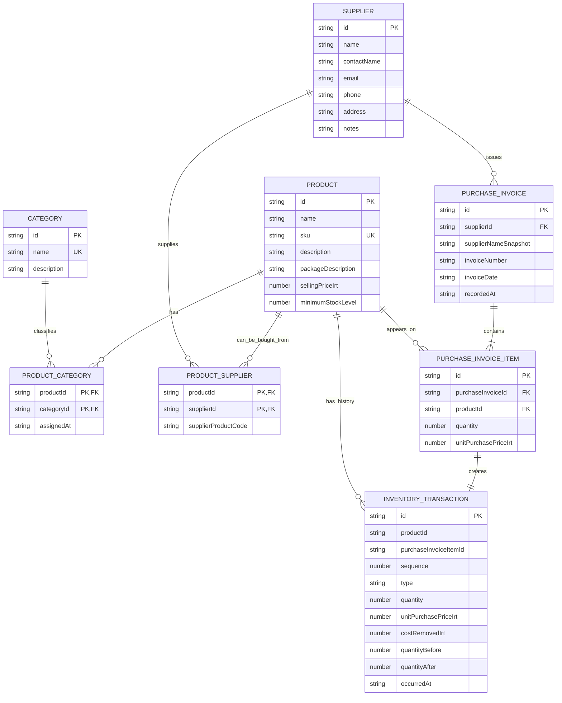

# Storix — Business Rules & Data Model

**Project:** Storix  
**Document:** Business Rules & Data Model  
**Version:** 1.2  
**Status:** Draft — owner decisions applied; inventory valuation and invoice cost adjustments require approval  
**Last Updated:** 2026-11-11  
**Primary Reference:** [`PRD.md`](./PRD.md)  
**Related Reference:** [`UI_UX_SPECIFICATION.md`](./UI_UX_SPECIFICATION.md)

---

## 1. Purpose

This document defines the business rules and conceptual data model for the Storix MVP.

It translates product requirements and approved product-owner decisions into data structures, relationships, validation rules, calculations, and operation constraints. It is a reference for UI design and frontend implementation.

This document covers:

- Products, categories, suppliers, and their many-to-many relationships.
- Count-based stock quantities and package descriptions.
- Supplier purchase invoices, supplier-specific latest purchase prices, selling prices, and inventory cost records.
- Inventory transactions and stock calculations.
- Sales analytics mock data and future reporting requirements.
- Data persistence in browser LocalStorage.
- Validation, data integrity, deletion rules, and acceptance scenarios.

This document does not define the final frontend folder structure, state management library, component architecture, backend, database server, authentication, or multi-user behavior.

## 2. Product Scope and Constraints

The data model must respect the current MVP scope.

| Constraint | Rule |
|---|---|
| Product domain | General-purpose inventory and sales-information management. |
| Warehouse | One warehouse only. |
| User context | One local user context; no authentication or roles. |
| Backend | Not included in the MVP. |
| Database | No server database; browser LocalStorage is used for editable app data. |
| Currency | IRT, displayed as تومان. Amounts are stored as integer tomans. |
| Stock unit | One countable item or package. Quantities are whole numbers only. |
| Sales data | Static mock data, separate from editable inventory data. |
| Sales operations | No real sales, sales orders, customers, sales invoices, or payment processing in the MVP. Supplier purchase invoices are in scope only to record stock receipts and actual acquisition prices. |
| Inventory operations | Interactive product, supplier, category, stock management, and basic purchase-invoice recording as part of Stock IN. |
| Purchase invoices | Record supplier invoice details and product-line quantities and unit purchase prices. This is stock-receipt recording, not a full purchasing, accounts-payable, or accounting module. |

`IRT` is the application currency identifier selected for Storix. The app stores integer toman amounts. Do not use a minor-unit conversion or decimal currency values for IRT.

The MVP has one currency. Multi-currency support is outside the current scope. Purchase prices are entered by the user from supplier invoices. Storix does not fetch or refresh purchase prices from online sources.

## 3. Approved Product-Owner Decisions

The following decisions were supplied and approved by the product owner on 2026-11-11.

| ID | Decision | Approved rule |
|---|---|---|
| A-01 | Currency | Use `IRT`, displayed as تومان. Store all money as integer toman amounts. |
| A-02 | Product-category relationship | Many-to-many. A product can belong to more than one category. A category can contain many products. |
| A-03 | Product-supplier relationship | Many-to-many. A product can be supplied by more than one supplier. A supplier can supply many products. |
| A-04 | Stock quantity unit | The inventory unit is always one countable item or package. |
| A-05 | Fractional stock quantity | Not supported. Stock quantities are non-negative whole numbers. |
| A-06 | Package contents | Package size or contents are descriptive product information. They do not change the stock quantity unit. |
| A-07 | Product prices | Storix must support actual purchase prices from supplier invoices and a current selling price. These values must support future sales and profit reports. |
| A-08 | Purchase-price source | Purchase prices are entered from each purchase invoice. Storix does not use live online prices or automatic price updates. |
| A-09 | Latest purchase price | Show the latest recorded purchase price and invoice date for each product-supplier pair. Derive the age of the price from the invoice date. |

Examples:

- `Rice — 5 kg bag`: stock quantity is the number of bags.
- `Cooking oil — 1.5 L bottle`: stock quantity is the number of bottles.
- `Keyboard`: stock quantity is the number of keyboards.

Do not store stock as kilograms, liters, meters, boxes, or other mixed units. A package with a different size or commercial SKU is a separate product when it must be tracked or priced separately.

## 4. Domain Concepts

### 4.1. Product

A Product is one distinct stock-keeping item or package. It has a unique SKU, a count-based stock unit, a current selling price, a minimum stock level, and descriptive package information when relevant.

A Product does not have one universal purchase price. The actual purchase price can vary by supplier and by purchase invoice. Each invoice line stores the amount paid per countable product unit. The latest purchase price for a product-supplier pair is derived from that supplier’s most recent recorded invoice line. Do not store or edit a manually maintained purchase-price value on Product or ProductSupplier.

### 4.2. Package Description

Package description explains what one countable product contains. Examples include `5 kg bag`, `12-unit box`, or `1.5 L bottle`.

This field is descriptive only. Storix does not calculate stock by multiplying the number of packages by the package contents in the MVP.

### 4.3. Category

A Category groups products for navigation, filtering, and reporting. A product can belong to zero, one, or many categories.

### 4.4. Supplier

A Supplier stores supplier contact information. A supplier can be connected to zero, one, or many products.

The product-supplier relationship identifies which products can be purchased from a supplier. It does not store a manually maintained purchase price. Actual purchase prices come from recorded purchase invoices.

### 4.5. Product-Supplier Relationship

This relationship connects one product to one supplier. It can store supplier-specific information such as the supplier's product code. The latest actual purchase price and invoice date are derived from purchase invoice history.

A product can have several supplier relationships. The same supplier can be related to several products. A product-supplier pair must be unique.

### 4.6. Purchase Invoice

A Purchase Invoice is a record of a supplier invoice entered by the user. It has one supplier and one or more product lines. Each line records a product, a whole-number quantity, and the actual purchase price per countable product unit. The invoice date comes from the supplier document. The record time shows when the invoice was entered into Storix.

A purchase invoice in the MVP is used to record incoming stock and preserve price history. It is not a purchase order, payment, accounts-payable record, tax document, or full accounting workflow.

### 4.7. Purchase Invoice Item

A Purchase Invoice Item represents one product line on a supplier invoice. Each item creates exactly one `STOCK_IN` inventory transaction when the invoice is saved. The invoice item and its inventory transaction must be saved together.

### 4.8. Inventory Transaction

An Inventory Transaction records one stock movement for one product. Supported types:

- `OPENING_STOCK`
- `STOCK_IN`
- `STOCK_OUT`

A transaction also stores the price or cost information needed to value inventory and preserve purchase history. Every `STOCK_IN` transaction must reference the purchase invoice item that created it.

A stock movement is not a sales event, sales order, or payment. A `STOCK_IN` movement is created from a supplier purchase invoice. In particular, `STOCK_OUT` does not automatically create sales revenue.

### 4.9. Sales Mock Entry

A Sales Mock Entry is a static reporting record. It represents a daily aggregate for one product. It stores quantity sold, revenue, and cost of goods sold for that reporting period.

It is not an individual sale, order, invoice, payment, or customer record.

### 4.10. App Settings

App Settings contain local display preferences supported by the MVP. The currency is fixed to IRT for this MVP and is not a user-editable setting.

## 5. Entity Relationship Model



`SalesMockEntry` and `AppSettings` are separate from the inventory relationship graph. Purchase invoices are part of the inventory workflow because each invoice item creates a stock receipt.

### 5.1. Relationship Rules

| Relationship | Cardinality | Rule |
|---|---|---|
| Product ↔ Category | Many-to-many | A product can have zero or many categories. A category can be assigned to zero or many products. |
| Product ↔ Supplier | Many-to-many | A product can have zero or many suppliers. A supplier can supply zero or many products. |
| Supplier → Purchase Invoice | One-to-many | One supplier can issue many purchase invoices. Each purchase invoice belongs to one supplier. |
| Purchase Invoice → Purchase Invoice Item | One-to-many | Each invoice has one or more product lines. |
| Product → Purchase Invoice Item | One-to-many | A product can appear on many supplier invoice lines over time. |
| Purchase Invoice Item → Inventory Transaction | One-to-one | Each saved invoice line creates exactly one Stock IN transaction. |
| Product → Inventory Transaction | One-to-many | A product can have zero or many historical stock transactions. |
| Product-Supplier pair | Unique pair | The same supplier must not be linked to the same product more than once. |
| Product-Category pair | Unique pair | The same category must not be linked to the same product more than once. |
| Sales Mock Entry → Product | Optional reference | A mock entry can link to an active product only through an explicit stable product ID. It must remain readable without that link. |

Use junction records for both many-to-many relationships. Do not store only one `categoryId` or one `supplierId` on Product.

## 6. Data Model

The following structures describe the conceptual TypeScript model. Final type names and file locations belong to Frontend Architecture.

### 6.1. Product

| Field | Type | Required | Rule |
|---|---|---:|---|
| `id` | `string` | Yes | Stable unique identifier. |
| `name` | `string` | Yes | Trim whitespace; must not be empty. |
| `sku` | `string` | Yes | Required and unique after normalization. |
| `description` | `string` | No | Plain text. |
| `packageDescription` | `string \| null` | No | Description of one package, such as `5 kg bag`. No effect on stock calculations. |
| `sellingPriceIrt` | `number \| null` | No | Null means no selling price is set. Otherwise, a non-negative safe integer in toman for one countable product unit. |
| `stockUnitCode` | `StockUnitCode` | Yes | Always `unit` in the MVP. The UI displays `عدد`; the user cannot change this value. |
| `minimumStockLevel` | `number` | Yes | Non-negative safe integer. Count of product units. |
| `createdAt` | `string` | Yes | ISO 8601 UTC timestamp. |
| `updatedAt` | `string` | Yes | ISO 8601 UTC timestamp. |

Product does not store a single `purchasePriceIrt`. Purchase prices can differ between suppliers and receipts. See ProductSupplier and InventoryTransaction.

#### Product Rules

1. Every product must have a non-empty name and a unique SKU.
2. SKU uniqueness is case-insensitive. Normalize by trimming whitespace and converting to uppercase before comparison and storage.
3. Product names do not need to be unique.
4. Every product represents one sellable or stockable item/package.
5. Every product quantity is counted in whole pieces. The UI can display the localized word `عدد` or a product-specific package label such as `کیسه` or `بطری`, but the stored quantity is an integer count.
6. `packageDescription` is descriptive only. It must not be used as a unit conversion factor.
7. A different package size that has a different SKU or price must be a separate Product.
8. `sellingPriceIrt` is the current selling/list price for one product unit. It can change over time. A price change must not rewrite historical sales mock data.
9. A null selling price means that no price is set. A value of zero means an intentional zero-price item. The UI must show these states differently.
10. `minimumStockLevel` is a whole number and defaults to zero unless the product owner selects another default.
11. Current stock is not stored as an independently editable Product field. It is derived from inventory transactions.
12. Editing product information must not change its stock quantity or historical transaction snapshots.
13. A product cannot be deleted while its current stock is greater than zero.

### 6.2. Category

| Field | Type | Required | Rule |
|---|---|---:|---|
| `id` | `string` | Yes | Stable unique identifier. |
| `name` | `string` | Yes | Trimmed; unique without case sensitivity. |
| `description` | `string` | No | Plain text. |
| `createdAt` | `string` | Yes | ISO 8601 UTC timestamp. |
| `updatedAt` | `string` | Yes | ISO 8601 UTC timestamp. |

Category names are unique after trimming and case normalization. A category cannot be deleted while one or more ProductCategory links reference it. The user must first remove or replace those category assignments.

### 6.3. ProductCategory

This junction entity implements the many-to-many relationship between products and categories.

| Field | Type | Required | Rule |
|---|---|---:|---|
| `productId` | `string` | Yes | References an existing Product. |
| `categoryId` | `string` | Yes | References an existing Category. |
| `assignedAt` | `string` | Yes | ISO 8601 UTC timestamp. |

The pair `productId + categoryId` must be unique. Product forms must allow the user to select multiple categories. A category can be removed from a product without deleting either record.

### 6.4. Supplier

| Field | Type | Required | Rule |
|---|---|---:|---|
| `id` | `string` | Yes | Stable unique identifier. |
| `name` | `string` | Yes | Trimmed; must not be empty. |
| `contactName` | `string` | No | Contact person, if known. |
| `email` | `string` | No | Validate format when provided. |
| `phone` | `string` | No | Store as text to preserve prefixes and formatting. |
| `address` | `string` | No | Plain text. |
| `notes` | `string` | No | Plain text. |
| `createdAt` | `string` | Yes | ISO 8601 UTC timestamp. |
| `updatedAt` | `string` | Yes | ISO 8601 UTC timestamp. |

Supplier names do not need to be unique. Email addresses do not need to be unique. A supplier cannot be hard-deleted while one or more ProductSupplier links or historical PurchaseInvoice records reference it. The user must remove product links first, but purchase history still blocks hard deletion. Supplier name snapshots on purchase invoices and inventory transactions must remain readable if supplier contact details change. A future archive/deactivate action can be considered separately.

### 6.5. ProductSupplier

This junction entity connects a product to one supplier. It stores supplier-specific catalog information only. Purchase prices are not stored here because they change with each supplier invoice.

| Field | Type | Required | Rule |
|---|---|---:|---|
| `productId` | `string` | Yes | References an existing Product. |
| `supplierId` | `string` | Yes | References an existing Supplier. |
| `supplierProductCode` | `string \| null` | No | Product code used by this supplier, if available. |
| `createdAt` | `string` | Yes | ISO 8601 UTC timestamp. |
| `updatedAt` | `string` | Yes | ISO 8601 UTC timestamp. |

Rules:

1. The pair `productId + supplierId` must be unique.
2. A product can have several supplier links and a supplier can have several product links.
3. Do not store `referencePurchasePriceIrt`, `lastPurchasePriceIrt`, or a manually editable price on this relationship.
4. The latest purchase price is derived from the most recent matching PurchaseInvoiceItem and its parent invoice.
5. A supplier-product link must exist before a product can be added to an invoice from that supplier. The invoice-entry flow may provide a way to create the link before saving the invoice.
6. A supplier-product link can be removed without deleting the Product or Supplier. Historical invoices and inventory transactions must keep their supplier and product snapshots.
7. Removing a link must not remove historical invoice lines or change the latest purchase price shown in historical records.

### 6.6. PurchaseInvoice

A PurchaseInvoice records the supplier document used to receive stock. One invoice belongs to one supplier and contains one or more line items.

| Field | Type | Required | Rule |
|---|---|---:|---|
| `id` | `string` | Yes | Stable unique identifier. |
| `supplierId` | `string` | Yes | References the supplier selected for this invoice. |
| `supplierNameSnapshot` | `string` | Yes | Supplier name at the time the invoice was recorded. |
| `invoiceNumber` | `string \| null` | No | Invoice number printed by the supplier, if provided. |
| `invoiceDate` | `string` | Yes | Date printed on the supplier invoice, `YYYY-MM-DD`. |
| `note` | `string` | No | Optional note. |
| `recordedAt` | `string` | Yes | ISO 8601 UTC timestamp when the invoice was entered and stock was posted in Storix. |

Rules:

1. A purchase invoice must have one supplier and at least one item. A product can appear only once on the invoice in the MVP. The pair `purchaseInvoiceId + productId` must be unique.
2. The supplier name is snapshotted so the invoice remains readable if the supplier record changes later.
3. The invoice date is the date used to show when the purchase price was valid. `recordedAt` is the time when Storix received the data and posted stock.
4. The invoice date may be earlier than `recordedAt` when the user enters an old paper invoice. Do not backdate the inventory ledger posting time.
5. Once saved, a posted invoice and its lines are immutable in the MVP. The MVP does not yet define an invoice-void or purchase-price correction workflow. Do not silently overwrite old purchase prices. Record this limitation clearly if a user reports an incorrect invoice; a correction workflow must be designed before accounting-sensitive use.
6. Invoice totals are derived from the line items. Do not store a duplicate total.
7. The MVP does not calculate invoice tax, freight, payment status, accounts payable, or supplier balances. The purchase unit cost entered on each line is the cost basis used by inventory valuation. Treatment of extra invoice charges is an open decision.

### 6.7. PurchaseInvoiceItem

A PurchaseInvoiceItem records one product line from a supplier invoice. The pair `purchaseInvoiceId + productId` must be unique in the MVP.

| Field | Type | Required | Rule |
|---|---|---:|---|
| `id` | `string` | Yes | Stable unique identifier. |
| `purchaseInvoiceId` | `string` | Yes | References an existing PurchaseInvoice. |
| `productId` | `string` | Yes | References the product received. |
| `productNameSnapshot` | `string` | Yes | Product name at the time of purchase. |
| `skuSnapshot` | `string` | Yes | Product SKU at the time of purchase. |
| `packageDescriptionSnapshot` | `string \| null` | No | Package description at the time of purchase. |
| `quantity` | `number` | Yes | Positive whole number of countable product units. |
| `unitPurchasePriceIrt` | `number` | Yes | Actual purchase price paid for one product unit, in integer tomans. |

The line total is derived as `quantity × unitPurchasePriceIrt`. Do not store a duplicate line total unless future invoice-level discounts or charges require a documented allocation rule.

Rules:

1. The product must be linked to the invoice supplier through ProductSupplier before the invoice is saved.
2. Quantity must be a positive safe integer.
3. Unit purchase price must be a non-negative safe integer in toman.
4. Each invoice item creates exactly one `STOCK_IN` transaction.
5. The same product cannot appear more than once on one invoice in the MVP. The UI must prevent duplicate product lines.
6. Invoice items are immutable after posting.
7. Store product snapshots so invoice history remains readable after a product is renamed or deleted.

### 6.8. Latest Purchase Price Projection

The latest purchase price is a derived view. Do not store a manually editable latest-price field on Product or ProductSupplier.

For each Product-Supplier pair:

1. Find all PurchaseInvoiceItems for the product whose parent PurchaseInvoice belongs to that supplier.
2. Sort by `invoiceDate` descending.
3. When invoice dates are equal, sort by `recordedAt` descending.
4. Use the first line as the latest purchase record.
5. Display its `unitPurchasePriceIrt`, supplier name, invoice date, and relative age.

For a product with several suppliers, show the latest purchase record for each supplier. A product-level "latest purchase" summary may show the most recent invoice line across all linked suppliers, but it must identify the supplier. Each invoice may contain only one line for a given product in the MVP; this avoids an ambiguous latest unit price when one source invoice repeats the same product at different prices. The UI must prevent duplicate product lines within one invoice.

The relative age (for example, `today`, `3 days ago`, or `2 months ago`) is calculated from `invoiceDate` at display time. Do not save the age as data. Do not call an online pricing service or update the value automatically.

If no matching purchase invoice exists, display `No recorded purchase` rather than zero.

### 6.9. Inventory Transaction

| Field | Type | Required | Rule |
|---|---|---:|---|
| `id` | `string` | Yes | Stable unique identifier. |
| `productId` | `string` | Yes | Retained historical identifier. It may not resolve to an active Product after deletion. |
| `productNameSnapshot` | `string` | Yes | Product name at the time of the movement. |
| `skuSnapshot` | `string` | Yes | SKU at the time of the movement. |
| `packageDescriptionSnapshot` | `string \| null` | No | Package description at the time of the movement. |
| `type` | `InventoryTransactionType` | Yes | `OPENING_STOCK`, `STOCK_IN`, or `STOCK_OUT`. |
| `purchaseInvoiceItemId` | `string \| null` | Conditional | References the invoice line for a purchase receipt. Required for `STOCK_IN`. |
| `sequence` | `number` | Yes | Increasing sequence for this product. Used to keep ledger order stable. |
| `quantity` | `number` | Yes | Positive whole number of product units. |
| `quantityBefore` | `number` | Yes | Stock immediately before the movement. |
| `quantityAfter` | `number` | Yes | Stock immediately after the movement. |
| `supplierIdSnapshot` | `string \| null` | Conditional | Required for `STOCK_IN`; optional for `OPENING_STOCK` if the original supplier is known. |
| `supplierNameSnapshot` | `string \| null` | Conditional | Required for `STOCK_IN`; optional for `OPENING_STOCK` if the original supplier is known. |
| `unitPurchasePriceIrt` | `number \| null` | Conditional | Actual acquisition price per product unit for `OPENING_STOCK` and `STOCK_IN`. Required when quantity is greater than zero. |
| `costRemovedIrt` | `number \| null` | Conditional | Total inventory cost removed by this `STOCK_OUT`, rounded once to a whole toman. Required for `STOCK_OUT` when using moving weighted average cost. |
| `reason` | `StockOutReason \| null` | Conditional | Required for `STOCK_OUT`; not used for `OPENING_STOCK`. |
| `note` | `string` | No | Optional user note. |
| `occurredAt` | `string` | Yes | ISO 8601 UTC timestamp created by the application. |

Transaction records are immutable in the MVP. They cannot be edited or deleted through the interface.

#### Transaction Price Rules

- `OPENING_STOCK`: Store the known acquisition cost per product unit. If opening quantity is greater than zero, this price is required for inventory valuation.
- `STOCK_IN`: Created only by saving a PurchaseInvoiceItem. Store the purchase invoice item ID, supplier ID and name snapshots, and actual unit purchase price. The price is taken from the invoice line entered by the user.
- `STOCK_OUT`: Store `costRemovedIrt`, the total inventory cost removed by the movement. Do not store a selling price in this transaction. A stock OUT operation is not a sale in the MVP.
- All prices are non-negative integer tomans.
- Transaction price snapshots do not change when Product selling price changes or when a newer supplier invoice is recorded.

A purchase receipt cannot be saved without a supplier invoice. Every invoice line product must be linked to that invoice supplier. Each product can appear only once on one invoice in the MVP. Each invoice line creates one Stock IN transaction.

### 6.10. SalesMockEntry

Sales data is a static dataset for analytics. Each row is a daily aggregate for one product key.

| Field | Type | Required | Rule |
|---|---|---:|---|
| `id` | `string` | Yes | Stable unique identifier. |
| `date` | `string` | Yes | Calendar date in `YYYY-MM-DD` format. |
| `productKey` | `string` | Yes | Stable key within the mock dataset. |
| `linkedProductId` | `string \| null` | No | Explicit link to a Product, when one exists. |
| `productNameSnapshot` | `string` | Yes | Name displayed even when there is no product link. |
| `skuSnapshot` | `string \| null` | No | SKU shown for reference. |
| `packageDescriptionSnapshot` | `string \| null` | No | Package description at the time represented by the mock data. |
| `quantitySold` | `number` | Yes | Positive whole number of countable product units. |
| `revenueIrt` | `number` | Yes | Non-negative integer toman amount for the aggregate. |
| `costOfGoodsSoldIrt` | `number` | Yes | Non-negative integer toman amount for the cost of the quantity sold. |

Rules:

1. There must be no more than one entry for the same `date + productKey` pair. Combine duplicate daily rows in the mock dataset.
2. The entry is an aggregate. It does not identify an individual buyer, order, invoice, or payment.
3. `revenueIrt` is the actual or simulated total selling amount for the aggregate. Do not recalculate it from the current Product selling price.
4. `costOfGoodsSoldIrt` is the cost assigned to the sold quantity in the mock dataset. Do not recalculate it from current inventory or current historical supplier invoice prices.
5. Gross profit is derived as `revenueIrt - costOfGoodsSoldIrt`.
6. A mock entry without `linkedProductId` must remain readable. Do not create a link based only on matching product names or SKUs.
7. Sales mock data is not stored in the editable inventory LocalStorage envelope.
8. Stock IN, Stock OUT, Product edits, and new PurchaseInvoice records must not modify SalesMockEntry records.

### 6.11. App Settings

| Field | Type | Required | Rule |
|---|---|---:|---|
| `theme` | `"light" \| "dark" \| "system"` | Yes | Default: `system`. |
| `tableDensity` | `"comfortable" \| "compact"` | Yes | Default: `comfortable`. |

Currency is fixed to IRT for this MVP. Do not add a currency selector to Settings.

## 7. Quantity and Package Rules

### 7.1. Inventory Unit

There is one inventory unit in the MVP: one countable product item or package. The storage code can be `unit`; the Persian display label is `عدد`.

Do not include `kg`, `g`, `L`, `m`, or similar measurement units as inventory quantity units.

### 7.2. Package Description

Examples:

| Product | Package Description | Stock Quantity | Stored Unit |
|---|---|---:|---|
| Rice | 5 kg bag | 25 | unit |
| Water | 1.5 L bottle | 48 | unit |
| Pen | Single pen | 120 | unit |
| Batteries | Pack of 4 | 15 | unit |

`25` rice bags means 25 stock units. The app can display the descriptive package text beside the product name, but must not convert the quantity to kilograms or liters.

### 7.3. Quantity Validation

1. Every stock quantity must be a finite, non-negative safe integer.
2. Every stock movement quantity must be a positive safe integer.
3. Minimum stock level must be a non-negative safe integer.
4. Decimal quantities are invalid.
5. Reject negative values, `NaN`, infinity, and values outside the supported integer range.
6. Do not offer unit conversion in the MVP.
7. A product's count unit cannot be changed because there is only one count unit.

## 8. Currency and Price Rules

### 8.1. Currency Representation

The selected application currency is `IRT`, displayed as `تومان`.

- Store all prices and totals as integer toman amounts.
- Do not store floating-point currency values.
- Do not mix rial and toman.
- Do not multiply or divide values by ten during display or calculation.
- Use one shared formatting utility for all UI money values.

### 8.2. Price Concepts

| Price | Stored On | Meaning | Can Change? |
|---|---|---|---|
| Actual purchase price | PurchaseInvoiceItem | Amount paid per countable product unit on this supplier invoice line. | No. Posted invoice lines are immutable. |
| Latest purchase price per supplier | Derived from PurchaseInvoiceItem + PurchaseInvoice | Most recent recorded unit purchase price for a product from one supplier, with invoice date. | Changes only when a newer invoice is recorded. |
| Current selling price | Product | Current list/default selling price for one product unit. | Yes. Historical sales data must not change. |
| Cost of goods sold | SalesMockEntry | Cost assigned to units represented by a sales aggregate. | No. It is a historical reporting snapshot. |

These values are related but are not interchangeable.

### 8.3. Purchase Price Source and Update Rules

1. Storix purchase prices come from supplier invoices entered by the user.
2. Storix does not fetch purchase prices from online sources, supplier websites, or live market feeds.
3. Do not add a manual "update latest purchase price" action.
4. When a PurchaseInvoice is saved, each line stores its actual unit purchase price and invoice date.
5. The latest purchase price for each product-supplier pair is derived from invoice history. It changes only when the user records a newer-dated invoice for that product and supplier.
6. A supplier can have different latest prices for different products. A product can have different latest prices from different suppliers.
7. Do not replace the historic price on an old invoice line when a later invoice has a different price.
8. The product detail view should show the latest recorded price and invoice date for each linked supplier. It should also show how long ago the invoice date was, calculated at display time.
9. A product-level latest-purchase summary must name the supplier. Never show a price without its supplier context when the product has multiple suppliers.
10. When no invoice history exists for a product-supplier pair, show `No recorded purchase`.

### 8.4. Actual Purchase Price and Invoice Totals

1. Every PurchaseInvoiceItem stores the actual price paid per countable product unit.
2. A line total is derived as `quantity × unitPurchasePriceIrt`.
3. Invoice total is derived as the sum of its line totals.
4. Do not recalculate old invoice line prices from current supplier or product data.
5. The unit purchase price is the cost input used by inventory valuation.
6. Tax, shipping, freight, invoice-wide discount, and other extra charges are not allocated in the MVP until the product owner approves a rule.
7. Positive opening stock still requires a unit acquisition cost. If its supplier is known, supplier ID and name can be stored as snapshots, but no supplier invoice is required for opening stock.

### 8.5. Selling Price

1. `Product.sellingPriceIrt` is the current expected/list selling price for one countable product unit or package.
2. It is editable on Product create/edit forms.
3. Changing this value must not modify inventory quantities, purchase invoices, purchase transactions, or historical sales reports.
4. The MVP does not create actual sale transactions or deduct stock through a sales workflow.
5. A future sales workflow must snapshot the actual selling price on each sale line. It must not use the current Product price to rewrite past sales.
6. The difference between current selling price and latest purchase price can be shown as an indicative comparison only. It is not actual profit because the actual sale price, discounts, extra costs, and inventory cost method may differ.

### 8.6. Gross Profit and Margin

Sales analytics can show these metrics because mock entries contain revenue and cost of goods sold.

- `Gross Profit = Revenue - Cost of Goods Sold`
- `Gross Margin (%) = (Gross Profit / Revenue) × 100`
- When revenue is zero, do not divide by zero. Display `—`.

Gross profit is not net profit. The MVP does not calculate tax, shipping, discounts, rent, payroll, overhead, or other operating expenses.

## 9. Inventory Valuation

### 9.1. Required Decision

The product owner has approved purchase-price and selling-price support. The cost method for valuing stock with different acquisition prices still requires approval.

**Recommended MVP method: Moving Weighted Average Cost (moving average).**

This method is suitable for the MVP because a product may be purchased from several suppliers at different prices. It produces one current average cost for the remaining stock without requiring the user to manage individual batches.

Do not mark this method as approved until the product owner confirms it.

### 9.2. Moving Weighted Average Formula

Let:

- `Q` = quantity on hand before a receipt.
- `V` = inventory value before a receipt.
- `q` = quantity received.
- `p` = actual purchase price per unit for the receipt.

After Stock IN:

`New Quantity = Q + q`

`New Inventory Value = V + (q × p)`

`New Average Cost = New Inventory Value / New Quantity`

For Stock OUT, calculate the cost removed from the inventory value and quantity immediately before the movement:

`Cost Removed (IRT) = round(Stock Out Quantity × (Inventory Value Before / Quantity Before))`

`New Inventory Value = Old Inventory Value - Cost Removed (IRT)`

The average unit cost remains conceptually the same after Stock OUT. Since the removed transaction total is stored as a whole toman amount, a small rounding difference can affect the recalculated average. If stock reaches zero, set the remaining inventory value to zero. The next receipt establishes a new average cost.

### 9.3. Currency Rounding

All stored money amounts are whole tomans. The average cost per unit can be fractional during calculation. Keep adequate internal precision for the average. For a Stock OUT transaction, calculate the total cost removed and round that transaction total once to a whole toman. Store this rounded total in `costRemovedIrt`. Use one shared rounding rule throughout the application. Do not round the average unit cost after every intermediate calculation.

The exact implementation must use safe integer checks for stored amounts and must detect values that exceed JavaScript's safe integer range. Any rounding difference must be deterministic and covered by unit tests.

### 9.4. Inventory Value KPI

If moving weighted average cost is approved:

`Estimated Inventory Value = Sum(Current Quantity × Current Moving Average Cost)`

This KPI is the estimated acquisition cost of stock on hand. It is not sales revenue, selling value, gross profit, or cash balance.

If cost is missing for an opening balance or receipt, the app must not silently treat unknown cost as zero. The current proposed MVP rule is to require a unit purchase cost for every positive opening balance and every Stock IN operation.

## 10. Inventory Business Rules

### 10.1. Current Stock Formula

For a product:

`Current Stock = OPENING_STOCK quantity + STOCK_IN quantity - STOCK_OUT quantity`

All values are whole product units. The inventory transaction ledger is the source of truth. Do not allow the user to type directly into the current stock field on a Product form.

### 10.2. Product Creation and Opening Stock

1. Create a Product with an initial stock quantity. The proposed default is zero.
2. If initial quantity is greater than zero, create exactly one `OPENING_STOCK` transaction in the same save operation.
3. The opening transaction has `quantityBefore = 0` and `quantityAfter = initialStockQuantity`.
4. A positive opening quantity requires the known acquisition cost per product unit.
5. A supplier can be selected only if it is linked to the product. Supplier selection can be empty when the original supplier is unknown or not registered. Opening stock is a separate initial balance. Do not create a PurchaseInvoice for it.
6. If the initial quantity is zero, do not create a transaction.
7. Do not create an extra `STOCK_IN` transaction for the opening quantity.
8. If product creation or persistence fails, neither the product nor its opening transaction may be partially saved.

### 10.3. Stock IN Through a Purchase Invoice

1. Stock IN is recorded by creating a PurchaseInvoice. Do not provide a separate Stock IN form that bypasses invoice history.
2. The invoice must have one supplier, a valid invoice date, and at least one line item.
3. Every line must select a Product that is linked to the invoice supplier.
4. Each line must include a positive whole-number quantity and the actual unit purchase price from the supplier invoice.
5. The unit purchase price is a non-negative safe integer in toman. A zero price is valid only when the user intentionally records a free or fully discounted item.
6. Each invoice line creates exactly one `STOCK_IN` transaction. The transaction must reference the source invoice item.
7. The stock ledger posting time is `recordedAt` / transaction `occurredAt`, not the printed invoice date. The printed invoice date is used for purchase-price history and relative-age display.
8. When the invoice is saved, create the invoice header, all invoice lines, all Stock IN transactions, and updated stock state as one logical operation.
9. If validation or persistence fails, save none of these records.
10. A purchase invoice and its posted lines are immutable in the MVP. Do not edit old purchase prices. Invoice voiding and purchase-price corrections are not supported until a complete stock-and-history reversal rule is approved.
11. The purchase line price can differ from the latest price previously recorded for that supplier and product. The new invoice line becomes the latest price only when its invoice date is the latest by the defined ordering rule.
12. One invoice line creates exactly one Stock IN transaction. The same product cannot appear twice on one invoice in the MVP.

### 10.4. Stock OUT

1. The selected product must exist.
2. Quantity must be a positive whole number.
3. Quantity must not exceed current stock.
4. Resulting stock must not be negative.
5. Create exactly one `STOCK_OUT` transaction only after all validation passes.
6. If moving weighted average cost is approved, calculate and snapshot the total cost removed using the current average cost. The stored amount is a whole toman total, not a rounded per-unit average.
7. A Stock OUT operation is an inventory removal or adjustment. It is not proof of a sale and does not change SalesMockEntry data.
8. The user must select a reason. Proposed reasons: `DAMAGE`, `INTERNAL_USE`, `ADJUSTMENT`, and `OTHER`. `SALE` is not a supported reason in the MVP because real sales operations are out of scope.
9. If validation or persistence fails, do not change stock and do not create a transaction.

### 10.5. Transaction Ordering and Immutability

1. Inventory transactions cannot be edited or deleted in the MVP.
2. A correction must be recorded as a new opposite movement with an explanatory note and a reason.
3. Do not backdate inventory movements in the MVP. The application creates `occurredAt` at submission time.
4. Each product transaction receives an increasing `sequence` value. Use this sequence to replay stock and cost calculations for that product.
5. Prevent duplicate submissions from creating duplicate transactions. Disable the submit action while an operation is being saved.
6. Every successful stock movement creates exactly one transaction record.
7. Store transaction snapshots so history remains readable after a product, supplier, or relationship changes.

### 10.6. Product Deletion

A product can be deleted only when its current stock is zero.

When a zero-stock product is deleted:

- Remove the Product record from the active catalog.
- Remove its ProductCategory and ProductSupplier links.
- Keep all related inventory transactions.
- Keep all PurchaseInvoice records and PurchaseInvoiceItem records that refer to this product.
- Keep transaction and invoice-line product name, SKU, package, supplier, unit cost, and quantity snapshots.
- Keep the historical `productId` value as an identifier only; it is not required to resolve to an active Product.
- Keep SalesMockEntry records. Do not delete a mock report row when its linked Product is deleted.

### 10.7. Category Deletion

A Category cannot be deleted while one or more ProductCategory links reference it. The user must first remove that category from each affected product. Do not delete related products.

### 10.8. Supplier Deletion

A Supplier cannot be hard-deleted while one or more ProductSupplier links or historical PurchaseInvoice records reference it. The user must remove product links first, but purchase history still blocks hard deletion. Supplier name snapshots on purchase invoices and inventory transactions must remain readable if supplier contact details change. A future archive/deactivate action can be considered separately.

## 11. Stock Status and Dashboard Rules

### 11.1. Stock Status

Let `Q` be current stock and `M` be the product's minimum stock level.

| Display Status | Condition |
|---|---|
| Out of Stock | `Q = 0` |
| Low Stock | `Q > 0` and `Q <= M` |
| In Stock | `Q > M` |

### 11.2. Low-Stock Count

The Dashboard low-stock KPI follows:

`Q <= M`

This count includes zero-stock products. The visible status of a zero-stock product remains `Out of Stock`.

### 11.3. Dashboard Metrics

| Metric | Calculation |
|---|---|
| Total Products | Count of active Product records. |
| Total Units in Stock | Sum current stock quantities across active products. This counts items or packages, not the physical contents inside them. |
| Low-Stock Products | Count active products where `currentStock <= minimumStockLevel`, including zero-stock products. |
| Estimated Inventory Value | Sum current stock multiplied by current moving average cost, only if the method is approved. |
| Recent Inventory Transactions | Latest transactions ordered by `occurredAt` descending, with `sequence` as a tie-breaker. |
| Best-Selling Products | Sales mock entries grouped by product and ranked by revenue by default. |

All stock quantities use the single count-based unit. `Total Units in Stock` can be calculated by summing current quantities across active products. This total counts stock items or packages; it does not represent kilograms, liters, or the combined physical contents of those packages.

## 12. Sales Analytics Rules

### 12.1. Separation from Inventory

1. Sales mock data is static application data, not part of editable inventory LocalStorage data.
2. Stock IN and Stock OUT do not create, update, or delete sales mock entries.
3. Product selling price changes do not rewrite historical sales mock data.
4. Recording a new supplier purchase invoice does not rewrite historical sales mock data.
5. Deleting a Product does not delete SalesMockEntry records.
6. A product link is shown only when `linkedProductId` points to an existing active Product.
7. A matching name or SKU alone is not enough to create a product link.

### 12.2. Revenue, Cost, and Gross Profit

For the selected date range:

`Total Revenue = Sum(revenueIrt)`

`Total Cost of Goods Sold = Sum(costOfGoodsSoldIrt)`

`Gross Profit = Total Revenue - Total Cost of Goods Sold`

`Gross Margin (%) = (Gross Profit / Total Revenue) × 100`

When total revenue is zero, do not divide by zero. Show an em dash or the agreed zero state.

### 12.3. Best-Selling Products and Comparisons

1. The default ranking is by total revenue, descending.
2. Show quantity sold as a whole count of packages/items.
3. Revenue comparisons use IRT and can compare different products.
4. Quantity comparisons count each product unit. The UI must show product/package labels so users can understand what one unit means.
5. Use product name as the final stable tie-breaker when revenue values are equal.
6. Label the comparison metric clearly, such as `Revenue (تومان)` or `Quantity (عدد)`.

### 12.4. Date-Range Rules

Sales mock entry dates use the date-only format `YYYY-MM-DD`.

- Quick ranges include the current browser-local calendar date.
- `Last 7 days`, `Last 30 days`, and `Last 90 days` include today and the preceding calendar days.
- `Last 12 months` starts on the first day of the calendar month 11 months before the current month and ends on the current browser-local date. Do not include future dates in the current month.
- A custom range includes both the selected start date and end date.
- Start date must not be after end date.
- All Sales Analytics widgets on one page use the same selected date range.
- The end date is inclusive because mock entries use calendar dates, not timestamps.

## 13. LocalStorage Data Envelope

Persist editable application data under one namespaced key:

`storix:app-data`

Proposed envelope:

```ts
interface StorixDataV2 {
  schemaVersion: 2;
  products: Product[];
  categories: Category[];
  productCategories: ProductCategory[];
  suppliers: Supplier[];
  productSuppliers: ProductSupplier[];
  purchaseInvoices: PurchaseInvoice[];
  purchaseInvoiceItems: PurchaseInvoiceItem[];
  inventoryTransactions: InventoryTransaction[];
  settings: AppSettings;
  updatedAt: string;
}
```

Sales mock entries are static application data and are not part of this envelope.

### 13.1. Persistence Rules

1. Load and validate the stored envelope before using it.
2. If no saved data exists, initialize empty inventory collections and default settings.
3. Write related changes in one serialized envelope. For example, Product creation and its opening stock transaction must be saved together. Purchase invoice header, all invoice items, their Stock IN transactions, and stock updates must also be saved together.
4. Do not report success until the LocalStorage write succeeds.
5. If a write fails, keep the previous persisted state and show a useful error.
6. Handle malformed or unsupported stored data safely. Do not silently overwrite data that cannot be parsed.
7. Include `schemaVersion` to support future migrations. Use version `2` for this proposed first implementation shape because purchase invoice collections are now part of persisted data.
8. Do not store SalesMockEntry records in LocalStorage.
9. The MVP has no cross-device synchronization or multi-user concurrency guarantees.

## 14. Validation and Data Integrity

| Data | Validation |
|---|---|
| Product name | Required after trimming. |
| SKU | Required; normalized; unique without case sensitivity. |
| Package description | Optional text. Must not affect quantity calculations. |
| Selling price | Null or a non-negative safe integer toman amount. Null means not set; zero means intentionally free. |
| Minimum stock | Non-negative safe integer. |
| ProductCategory | Both records must exist; pair must be unique. |
| Supplier name | Required after trimming. |
| ProductSupplier | Both records must exist; pair must be unique. |
| PurchaseInvoiceItem | Invoice-product pair must be unique. |
| Purchase invoice supplier | Required; supplier must exist. |
| Purchase invoice date | Required valid `YYYY-MM-DD` date from the supplier document. |
| Purchase invoice items | At least one line per invoice; no duplicate product lines within one invoice. |
| Purchase invoice item product | Product must exist and be linked to the invoice supplier. |
| Purchase invoice quantity | Positive safe integer count. |
| Purchase invoice unit price | Non-negative safe integer toman amount from the invoice. |
| Opening stock acquisition cost | Required for positive opening stock; non-negative safe integer toman amount. |
| Latest purchase price display | Derived from the latest invoice line per product-supplier pair; age is derived from invoice date. |
| Stock quantity | Non-negative safe integer. |
| Movement quantity | Positive safe integer. |
| Stock OUT | Cannot exceed current stock. |
| Transaction snapshots | Must be present when required and remain immutable. |
| Stock OUT reason | Must use a supported reason value. |
| Sales quantity | Positive safe integer. |
| Sales revenue | Non-negative safe integer toman amount. |
| Sales cost of goods sold | Non-negative safe integer toman amount. |
| Sales date | Valid `YYYY-MM-DD` calendar date. |
| Sales mock uniqueness | At most one entry for each `date + productKey` pair. |

All numeric inputs must reject blank strings when the field is required, `NaN`, infinite values, negative values where prohibited, decimals for quantity, and values outside the safe integer range.

## 15. Proposed TypeScript Types

These types show the intended domain shape. Final file locations and implementation details belong to Frontend Architecture.

```ts
export type CurrencyCode = "IRT";
export type StockUnitCode = "unit";

export type InventoryTransactionType =
  | "OPENING_STOCK"
  | "STOCK_IN"
  | "STOCK_OUT";

export type StockOutReason =
  | "DAMAGE"
  | "INTERNAL_USE"
  | "ADJUSTMENT"
  | "OTHER";

export interface Product {
  id: string;
  name: string;
  sku: string;
  description?: string;
  packageDescription?: string | null;
  stockUnitCode: StockUnitCode;
  sellingPriceIrt: number | null;
  minimumStockLevel: number;
  createdAt: string;
  updatedAt: string;
}

export interface Category {
  id: string;
  name: string;
  description?: string;
  createdAt: string;
  updatedAt: string;
}

export interface ProductCategory {
  productId: string;
  categoryId: string;
  assignedAt: string;
}

export interface Supplier {
  id: string;
  name: string;
  contactName?: string;
  email?: string;
  phone?: string;
  address?: string;
  notes?: string;
  createdAt: string;
  updatedAt: string;
}

export interface ProductSupplier {
  productId: string;
  supplierId: string;
  supplierProductCode?: string | null;
  createdAt: string;
  updatedAt: string;
}

export interface PurchaseInvoice {
  id: string;
  supplierId: string;
  supplierNameSnapshot: string;
  invoiceNumber: string | null;
  invoiceDate: string; // YYYY-MM-DD from the supplier document
  note?: string;
  recordedAt: string; // ISO 8601 UTC timestamp
}

export interface PurchaseInvoiceItem {
  id: string;
  purchaseInvoiceId: string;
  productId: string;
  productNameSnapshot: string;
  skuSnapshot: string;
  packageDescriptionSnapshot?: string | null;
  quantity: number;
  unitPurchasePriceIrt: number;
}

export interface InventoryTransaction {
  id: string;
  productId: string;
  productNameSnapshot: string;
  skuSnapshot: string;
  packageDescriptionSnapshot?: string | null;
  type: InventoryTransactionType;
  purchaseInvoiceItemId?: string | null;
  sequence: number;
  quantity: number;
  quantityBefore: number;
  quantityAfter: number;
  supplierIdSnapshot?: string | null;
  supplierNameSnapshot?: string | null;
  unitPurchasePriceIrt?: number | null;
  costRemovedIrt?: number | null;
  reason?: StockOutReason | null;
  note?: string;
  occurredAt: string;
}

export interface SalesMockEntry {
  id: string;
  date: string;
  productKey: string;
  linkedProductId: string | null;
  productNameSnapshot: string;
  skuSnapshot: string | null;
  packageDescriptionSnapshot?: string | null;
  quantitySold: number;
  revenueIrt: number;
  costOfGoodsSoldIrt: number;
}

export interface AppSettings {
  theme: "light" | "dark" | "system";
  tableDensity: "comfortable" | "compact";
}
```

## 16. MVP Acceptance Scenarios

### 16.1. Product with Multiple Categories and Suppliers

1. Create two categories: `Food` and `Packaged Goods`.
2. Create two suppliers: `Supplier A` and `Supplier B`.
3. Create a product: `Rice — 5 kg bag`.
4. Assign both categories to the product.
5. Link both suppliers to the product.
6. Record a purchase invoice from each supplier at its actual unit price.
7. Verify that the product shows both categories and both suppliers.
8. Verify that the product has one selling price and an integer stock quantity.
9. Verify that the same category or supplier cannot be linked to the same product twice.

### 16.2. Count-Based Package Stock

1. Create a product named `Rice — 5 kg bag` with package description `5 kg bag`.
2. Set its opening quantity to `25` and its acquisition price to `120000` IRT per bag.
3. Verify current stock is `25 عدد` or `25 bags`.
4. Verify that stock is not displayed or stored as `125 kg`.
5. Record a supplier purchase invoice for `10` bags.
6. Verify current stock is `35` packages.
7. Attempt to enter `1.5` as a movement quantity.
8. Verify the input is rejected.

### 16.3. Purchase Invoice Creates Stock IN

1. Create a supplier and link it to Product A.
2. Create a purchase invoice for that supplier with an invoice date and two product lines.
3. Verify each line stores a whole-number quantity and a unit purchase price in IRT.
4. Save the invoice.
5. Verify the invoice header, both lines, and exactly two Stock IN transactions are saved together.
6. Verify current stock increases by the sum of the line quantities.
7. Verify the latest purchase price view shows the price and invoice date for each product-supplier pair.
8. Attempt to add the same product twice to one invoice. Verify the duplicate is blocked.
9. Attempt to save an invoice line for a product that is not linked to the invoice supplier. Verify that the operation is blocked or the relationship must first be added.
10. Simulate a persistence failure. Verify that the invoice and its stock transactions are not partially saved.

### 16.4. Latest Purchase Price by Supplier and Invoice Date

1. Link Product A to Supplier A and Supplier B.
2. Record a Supplier A purchase invoice dated `2026-10-01` with Product A quantity `10` at `118000` IRT per unit.
3. Verify the Product A / Supplier A latest purchase price is `118000` IRT and the date is `2026-10-01`.
4. Record a later Supplier A invoice dated `2026-11-05` with Product A quantity `5` at `121000` IRT per unit.
5. Verify the latest price for Product A from Supplier A is now `121000` IRT and the date is `2026-11-05`.
6. Verify the first invoice still shows `118000` IRT per unit.
7. Record a Supplier B invoice at a different price.
8. Verify Product A shows a separate latest price and date for Supplier B.
9. Verify the product-level latest-purchase summary identifies which supplier provided that price.
10. Verify that no price changes unless a user records a supplier invoice. Storix must not fetch online prices.
11. Verify the relative age label is derived from invoice date and is not stored.

### 16.5. Selling Price and Historical Sales Data

1. Create Product A with selling price `160000` IRT.
2. Load a SalesMockEntry with quantity, revenue, and cost of goods sold.
3. Change the current Product selling price to `170000` IRT.
4. Verify the historical SalesMockEntry revenue and cost remain unchanged.
5. Verify gross profit is calculated as revenue minus cost of goods sold.

### 16.6. Opening Stock Zero

1. Create a product with initial stock `0`.
2. Verify the product is saved with current stock `0`.
3. Verify no opening stock transaction is created.

### 16.7. Stock IN and Stock OUT

1. Create a product with opening stock `20` and an acquisition cost.
2. Record a supplier purchase invoice that adds `10` units at a different actual purchase price.
3. Record Stock OUT of `5` for `INTERNAL_USE`.
4. Verify current stock is `25` countable units.
5. Attempt Stock OUT of `26` units.
6. Verify the operation is rejected, stock remains `25`, and no transaction is created.

### 16.8. Product Deletion and History

1. Create a product and record opening stock.
2. Verify deletion is blocked while stock is greater than zero.
3. Record valid Stock OUT operations until stock reaches zero.
4. Delete the product.
5. Verify the product is no longer in the active product list.
6. Verify its historical transactions and purchase invoice lines remain readable with product, package, supplier, and price snapshots.
7. Verify related SalesMockEntry records remain readable.

### 16.9. Category and Supplier Deletion

1. Assign a product to a category and link it to a supplier.
2. Attempt to delete the category and supplier.
3. Verify both deletions are blocked while the relationships exist.
4. Remove the category and supplier product links.
5. Verify the category can now be deleted if no product uses it.
6. Record a purchase invoice from the supplier, then attempt to delete that supplier.
7. Verify supplier deletion remains blocked because purchase history exists.
8. Verify historic invoice and transaction snapshots remain readable.

### 16.10. IRT Formatting

1. Enter a selling price of `160000`.
2. Verify the UI displays `۱۶۰٬۰۰۰ تومان` in Persian locale or an equivalent consistent localized format.
3. Verify the stored value remains the integer `160000`.
4. Verify the app does not convert toman to rial or apply decimal minor-unit scaling.

## 17. Decisions and Dependencies

### 17.1. Approved Decisions

| ID | Decision | Approved Value | Status |
|---|---|---|---|
| A-01 | Currency | IRT / toman | Approved |
| A-02 | Product-category cardinality | Many-to-many | Approved |
| A-03 | Product-supplier cardinality | Many-to-many | Approved |
| A-04 | Stock quantity unit | Countable product unit/package | Approved |
| A-05 | Quantity precision | Whole integers only | Approved |
| A-06 | Package contents | Descriptive; no quantity conversion | Approved |
| A-07 | Price support | Invoice-based purchase prices and current selling price | Approved |
| A-08 | Purchase-price source | User-entered supplier invoices; no live online price feed | Approved |
| A-09 | Latest purchase price | Derived per product-supplier pair from the latest invoice date; show invoice date and relative age | Approved |
| A-10 | Purchase invoice capture | Basic supplier invoice header and line capture as part of Stock IN | Approved |

### 17.2. Remaining Decisions

| ID | Decision | Recommendation | Status |
|---|---|---|---|
| D-01 | Inventory valuation method | Moving Weighted Average Cost. It handles different invoice prices without lot-level stock tracking. | Requires approval |
| D-02 | Default minimum stock | Default to zero; allow the user to set a threshold per product. | Proposed |
| D-03 | Zero selling price | Allow zero only for intentionally free items; otherwise require a positive price. | Proposed |
| D-04 | Opening stock cost | Require known acquisition cost per unit when opening quantity is greater than zero. | Proposed |
| D-05 | Purchase invoice price basis | Confirm how to handle invoice-level discount, tax, shipping, and other charges. | Requires approval |
| D-06 | Stock OUT reasons | DAMAGE, INTERNAL_USE, ADJUSTMENT, OTHER. Do not include SALE in the MVP. | Proposed |
| D-07 | Purchase invoice corrections | Posted invoices remain immutable. Define a void/reversal workflow that corrects both stock and price history before supporting invoice corrections. A stock adjustment alone must not change the recorded latest purchase price. | Requires approval |

### 17.3. Required PRD Updates

Update the PRD to:

1. Set currency to IRT and define all monetary values as integer tomans.
2. Define stock quantity as whole countable product units. Package contents are descriptive and do not affect stock quantity.
3. Define Product-Category and Product-Supplier as many-to-many relationships.
4. Add basic supplier purchase invoice recording to Stock IN, including invoice date, supplier, product lines, quantity, and actual unit purchase price.
5. Define latest purchase price as a derived value per product-supplier pair, based on the latest recorded invoice date. Show the invoice date and relative age.
6. State that purchase prices are entered from invoices and are not fetched from online sources.
7. Add current selling price to Product.
8. Define inventory valuation method and inventory value calculation after approval.
9. Add gross profit and gross margin to Sales Analytics mock-data requirements, if approved for the MVP.
10. Clarify that Stock OUT is not a sale and does not update sales analytics.
11. Keep real sales, sales orders, customers, sales invoices, and payments outside the MVP unless the product owner changes scope. Supplier purchase invoices are included only to record incoming stock and acquisition prices.

### 17.4. Required UI/UX Specification Updates

Update the UI/UX specification to:

1. Use integer count quantities and display `عدد` or the product package label.
2. Add `packageDescription` to Product create/edit and product detail views.
3. Allow multi-select categories on Product create/edit forms.
4. Allow multiple supplier links for each product.
5. Remove manual supplier reference-price fields.
6. Add current selling price to Product create/edit and product details.
7. Add a purchase invoice entry flow within Stock IN. Include supplier, invoice date, optional invoice number, and one or more product lines.
8. Capture quantity and actual unit purchase price on each purchase invoice line.
9. Show the latest recorded purchase price, supplier, invoice date, and relative age for each product-supplier pair.
10. Show opening stock acquisition cost when opening quantity is greater than zero.
11. Add a Stock OUT reason field.
12. Display money consistently in IRT / تومان.
13. Keep Sales Analytics independent from stock movement and purchase invoice forms.

## 18. Definition of Done

This phase is complete when:

- [x] Currency IRT / toman is selected.
- [x] Product-category many-to-many relationship is selected.
- [x] Product-supplier many-to-many relationship is selected.
- [x] Stock quantity is defined as a whole count of sellable/stockable product units.
- [x] Package contents are defined as descriptive information only.
- [x] Purchase prices are sourced from supplier invoices and remain immutable as historical records.
- [x] Latest purchase price and invoice date are derived per product-supplier pair.
- [x] Current selling price is separate from historical purchase prices.
- [ ] Inventory valuation method is approved.
- [ ] Remaining proposed validation and stock operation rules are approved.
- [ ] PRD reflects all approved business rules, including purchase invoice capture.
- [ ] UI/UX specification reflects purchase invoice entry and latest-price display.
- [ ] Acceptance scenarios cover normal, boundary, and invalid operations.

## 19. Document Control

| Property | Value |
|---|---|
| Document | Storix Business Rules & Data Model |
| Version | 1.2 |
| Status | Draft — owner decisions applied; valuation and invoice charge treatment require approval |
| Primary Reference | `docs/PRD.md` |
| Related Reference | `docs/UI_UX_SPECIFICATION.md` |
| Next Step | Confirm invoice charge treatment and inventory valuation method, then align PRD and UI/UX Specification. |


## 20. Change Log

| Version | Date | Changes |
|---|---|---|
| 1.2 | 2026-11-11 | Replaced manual supplier reference prices with invoice-based purchase history. Added PurchaseInvoice and PurchaseInvoiceItem. Defined latest purchase price per product-supplier pair with invoice date and derived relative age. Added purchase invoice entry to Stock IN scope. |
| 1.1 | 2026-11-11 | Applied IRT currency, many-to-many product relationships, and count-based package stock decisions. |
