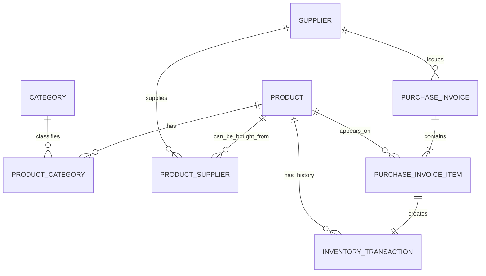

# Storix — Business Rules & Data Model

**Document:** Business Rules & Data Model  
**Version:** 1.3  
**Status:** Draft for cross-document review — not approved for implementation  
**Last Updated:** 2026-11-11  
**Product:** Storix  
**Primary Reference:** [`PRD.md`](./PRD.md)  
**Related Reference:** [`UI_UX_SPECIFICATION.md`](./UI_UX_SPECIFICATION.md)

---

## 1. Purpose and Authority

This document defines the domain concepts, data relationships, validation rules, inventory rules, and calculations for the Storix MVP.

Use this document with the PRD and UI/UX Specification:

- The **PRD** defines the product scope and the functional and non-functional requirements.
- This document defines the business meaning, data rules, and calculations behind those requirements.
- The **UI/UX Specification** defines how users see and use the approved product behavior.
- Frontend Architecture will define implementation details. It must not change the business rules in this document.

A decision marked **Approved** is a confirmed product-owner decision. A decision marked **Proposed** or **Requires approval** is not final. Do not implement it as a confirmed rule until the product owner approves it.

If documents conflict, do not choose a rule by assumption. Record the conflict and resolve it across all affected documents.

## 2. Product Scope and Constraints

Storix is a general-purpose, frontend-focused application that combines inventory management with sales information and analytics.

| Area | MVP rule |
|---|---|
| Business domain | General-purpose. The product is not limited to one industry. |
| Warehouse | One warehouse only. |
| User context | One local user context. No authentication, accounts, or roles. |
| Backend | Not included. |
| Server database | Not included. |
| Editable data | Stored in browser LocalStorage. |
| Sales information | Static mock data. Read-only in the MVP. |
| Currency | Application currency identifier `IRT`; display as `تومان`. Store integer toman amounts. |
| Stock unit | One countable product item or package. |
| Quantity precision | Whole numbers only. |
| Stock receipt | Recorded through a supplier Purchase Invoice. There is no separate manual Stock IN form in the MVP. |
| Stock removal | Recorded through Stock OUT. It is not a sale. |
| Purchase invoices | Basic supplier invoice capture for stock receipt and purchase-price history only. |
| Sales operations | Real sales, sales orders, customers, sales invoices, and payments are outside the MVP. |

`IRT` is an application-level identifier in this project. The interface must display `تومان`. Do not convert values to rial or apply a factor of ten.

Purchase prices are entered by the user from supplier documents. Storix does not fetch prices from supplier websites or live market feeds.

The purchase-invoice feature is not a complete purchasing, accounting, tax, or accounts-payable module. It records the supplier document details needed to explain incoming stock and the entered unit purchase prices.

## 3. Approved Product-Owner Decisions

The following decisions are recorded as approved in the current project documentation.

| ID | Decision | Approved rule |
|---|---|---|
| A-01 | Currency | Use application currency identifier `IRT`; display amounts as تومان; store integer toman amounts. |
| A-02 | Product-category relationship | Many-to-many. A product can belong to zero, one, or many categories. A category can contain many products. |
| A-03 | Product-supplier relationship | Many-to-many. A product can be linked to more than one supplier. A supplier can supply many products. |
| A-04 | Stock unit | One countable item or package. The stored unit code is `unit`; the Persian display label is `عدد`. |
| A-05 | Quantity precision | Stock quantities and movement quantities are whole numbers only. |
| A-06 | Package contents | Package size or contents are descriptive. They do not change stock quantity or trigger unit conversion. |
| A-07 | Price support | Product records support a current selling price. Supplier purchase prices are recorded from invoice lines. |
| A-08 | Purchase-price source | Purchase prices are entered by the user from supplier invoices. No online price feed is used. |
| A-09 | Latest purchase price | Derive the latest recorded price and invoice date for each product-supplier pair. Derive its age from the invoice date. |
| A-10 | Purchase invoice capture | Basic supplier invoice header and line capture is part of Stock IN. Each saved invoice line creates one Stock IN transaction. |

Examples of the stock unit:

| Product | Package description | Stock quantity | Stored unit |
|---|---|---:|---|
| Rice | 5 kg bag | 25 | `unit` |
| Water | 1.5 L bottle | 48 | `unit` |
| Pen | Single pen | 120 | `unit` |
| Batteries | Pack of 4 | 15 | `unit` |

`25` rice bags means 25 packages. Storix does not convert that quantity to kilograms.

## 4. Domain Concepts

### 4.1. Product

A Product represents one distinct stock-keeping item or package. It has a unique SKU, a count-based stock unit, a current selling price, a minimum stock threshold, and optional package information.

A Product does not have one universal purchase price. Purchase price can vary by supplier and by invoice. Do not store a manually editable purchase price on Product or ProductSupplier.

### 4.2. Category

A Category groups products for navigation, filtering, and reporting. Product-category membership is many-to-many.

### 4.3. Supplier

A Supplier stores supplier contact information. Supplier-product relationships and purchase-invoice history identify the products supplied by that supplier.

### 4.4. Product-Supplier Relationship

This relationship identifies that a product can be purchased from a supplier. It may store a supplier-specific product code. It does not store a purchase price.

The latest purchase price is derived from Purchase Invoice history.

### 4.5. Purchase Invoice

A Purchase Invoice is a record of a supplier document entered by the user. One invoice belongs to one supplier and contains one or more product lines.

Each line stores:

- One product.
- A positive whole-number quantity.
- The entered purchase price for one countable product unit, in integer tomans.

The invoice date comes from the supplier document. The record time is the time when the user saves the invoice in Storix.

A saved invoice posts stock. It is not a purchase order, payment record, or accounts-payable entry.

### 4.6. Inventory Transaction

An Inventory Transaction is an immutable record of a stock balance change. The MVP supports these types:

- `OPENING_STOCK`: the initial quantity entered when a product is created.
- `STOCK_IN`: a receipt created by one Purchase Invoice line.
- `STOCK_OUT`: a quantity removed from available stock for a non-sale reason.

A Stock OUT record is not a sales transaction. It must not update Sales Analytics.

### 4.7. Sales Mock Entry

A Sales Mock Entry is a static sample record used only for Sales Analytics. It is not an inventory transaction and it does not represent an order or payment processed by Storix.

### 4.8. Price Concepts

| Price | Source | Meaning | History rule |
|---|---|---|---|
| Unit purchase price | Purchase Invoice Item | Entered purchase price for one countable unit on one supplier invoice line. | Immutable after posting. |
| Latest purchase price per supplier | Derived from invoice history | Latest recorded unit price for one product from one supplier. | Recalculated from invoice history. |
| Current selling price | Product | Current list/default selling price for one unit. | Can change. Do not rewrite sales mock history. |
| Cost of goods sold | Sales Mock Entry | Historical cost attached to the sample sales record. | Static mock-data value. |

Do not present these values as interchangeable.

## 5. Entity Relationships



| Relationship | Cardinality | Rule |
|---|---|---|
| Product ↔ Category | Many-to-many | Use ProductCategory as the junction entity. |
| Product ↔ Supplier | Many-to-many | Use ProductSupplier as the junction entity. |
| Supplier → Purchase Invoice | One-to-many | Each invoice has exactly one supplier. |
| Purchase Invoice → Purchase Invoice Item | One-to-many | Each posted invoice has one or more lines. |
| Product → Purchase Invoice Item | One-to-many | A product may appear on many invoices over time. |
| Purchase Invoice Item → Inventory Transaction | One-to-one | Each invoice line creates exactly one Stock IN transaction. |
| Product → Inventory Transaction | One-to-many | A product can have many historical transactions. |

## 6. Data Model

These are conceptual TypeScript shapes. Final file names, folder locations, state management, and persistence implementation belong to Frontend Architecture.

### 6.1. Product

| Field | Type | Required | Rule |
|---|---|---:|---|
| `id` | `string` | Yes | Stable unique identifier. |
| `name` | `string` | Yes | Trim whitespace. Must not be empty. |
| `sku` | `string` | Yes | Required. Unique after trimming and case normalization. |
| `description` | `string \| null` | No | Plain text. |
| `packageDescription` | `string \| null` | No | Description of one stock unit, such as `5 kg bag`. Does not affect quantity calculations. |
| `sellingPriceIrt` | `number \| null` | Decision pending | Integer toman amount for one stock unit. `null` means not set. Zero-price behavior is D-03. |
| `stockUnitCode` | `"unit"` | Yes | Fixed in the MVP. Display as `عدد`. The user cannot change it. |
| `minimumStockLevel` | `number` | Yes | Non-negative safe integer. Default behavior is D-02. |
| `createdAt` | `string` | Yes | ISO 8601 UTC timestamp. |
| `updatedAt` | `string` | Yes | ISO 8601 UTC timestamp. |

Current stock is derived from Inventory Transactions. Do not store a user-editable stock quantity on Product.

### 6.2. Category

| Field | Type | Required | Rule |
|---|---|---:|---|
| `id` | `string` | Yes | Stable unique identifier. |
| `name` | `string` | Yes | Trimmed; unique without case sensitivity. |
| `description` | `string \| null` | No | Plain text. |
| `createdAt` | `string` | Yes | ISO 8601 UTC timestamp. |
| `updatedAt` | `string` | Yes | ISO 8601 UTC timestamp. |

A category cannot be deleted while ProductCategory links reference it. The user must first remove its product assignments.

### 6.3. ProductCategory

| Field | Type | Required | Rule |
|---|---|---:|---|
| `productId` | `string` | Yes | References an active Product. |
| `categoryId` | `string` | Yes | References an active Category. |
| `assignedAt` | `string` | Yes | ISO 8601 UTC timestamp. |

The pair `productId + categoryId` must be unique. A product can have multiple categories. Removing a link does not delete either parent record.

### 6.4. Supplier

| Field | Type | Required | Rule |
|---|---|---:|---|
| `id` | `string` | Yes | Stable unique identifier. |
| `name` | `string` | Yes | Trimmed; must not be empty. |
| `contactName` | `string \| null` | No | Contact person, if known. |
| `email` | `string \| null` | No | Validate format when provided. |
| `phone` | `string \| null` | No | Store as text to preserve prefixes and formatting. |
| `address` | `string \| null` | No | Plain text. |
| `notes` | `string \| null` | No | Plain text. |
| `createdAt` | `string` | Yes | ISO 8601 UTC timestamp. |
| `updatedAt` | `string` | Yes | ISO 8601 UTC timestamp. |

### 6.5. ProductSupplier

| Field | Type | Required | Rule |
|---|---|---:|---|
| `productId` | `string` | Yes | References an active Product. |
| `supplierId` | `string` | Yes | References an active Supplier. |
| `supplierProductCode` | `string \| null` | No | Product code used by this supplier, if available. |
| `createdAt` | `string` | Yes | ISO 8601 UTC timestamp. |
| `updatedAt` | `string` | Yes | ISO 8601 UTC timestamp. |

Rules:

1. The pair `productId + supplierId` must be unique.
2. A product can link to several suppliers. A supplier can link to several products.
3. Do not store a reference price or latest price on this relationship.
4. Derive the latest purchase price from Purchase Invoice history.
5. A link can be removed without deleting the Product or Supplier. Historical invoices and transactions must retain their snapshots.
6. Removing a link must not change historical invoice lines or historical purchase prices.

### 6.6. PurchaseInvoice

| Field | Type | Required | Rule |
|---|---|---:|---|
| `id` | `string` | Yes | Stable unique identifier. |
| `supplierId` | `string` | Yes | References the supplier selected for the invoice. Retain as a historical identifier if the supplier is later unavailable. |
| `supplierNameSnapshot` | `string` | Yes | Supplier name when the invoice was posted. |
| `invoiceNumber` | `string \| null` | No | Number printed by the supplier, if available. |
| `invoiceDate` | `string` | Yes | Valid calendar date in `YYYY-MM-DD` format. |
| `note` | `string \| null` | No | Optional plain-text note. |
| `recordedAt` | `string` | Yes | ISO 8601 UTC timestamp when the invoice was saved and stock was posted. |

Rules:

1. One invoice has exactly one supplier and at least one line.
2. A product can appear only once on an invoice in the MVP.
3. The pair `purchaseInvoiceId + productId` must be unique.
4. The supplier name is snapshotted for historical readability.
5. `invoiceDate` determines the date used for latest-price ordering. `recordedAt` records when Storix received the data.
6. A posted invoice is immutable. D-07 controls whether a reversal workflow will be supported.
7. Invoice-level discounts, taxes, shipping, and other charges are not fully defined until D-05 is approved. Do not present a line subtotal as a final payable invoice total.

### 6.7. PurchaseInvoiceItem

| Field | Type | Required | Rule |
|---|---|---:|---|
| `id` | `string` | Yes | Stable unique identifier. |
| `purchaseInvoiceId` | `string` | Yes | References the parent invoice. |
| `productId` | `string` | Yes | References the product received. Retain as a historical identifier if the active product is deleted. |
| `productNameSnapshot` | `string` | Yes | Product name when the invoice was posted. |
| `skuSnapshot` | `string` | Yes | Product SKU when the invoice was posted. |
| `packageDescriptionSnapshot` | `string \| null` | No | Package description when the invoice was posted. |
| `quantity` | `number` | Yes | Positive safe integer count of product units. |
| `unitPurchasePriceIrt` | `number` | Yes | Entered unit purchase price in integer tomans. D-05 defines the treatment of invoice-level adjustments. |

The line amount before invoice-level adjustments is derived as `quantity × unitPurchasePriceIrt`. Do not call this the final invoice payable amount while D-05 remains open.

Rules:

1. The product must be linked to the invoice supplier before the invoice is posted.
2. Quantity must be a positive safe integer.
3. Unit purchase price must be a non-negative safe integer in toman.
4. Each posted line creates exactly one `STOCK_IN` transaction.
5. The same product cannot appear twice on one invoice in the MVP.
6. Posted invoice lines are immutable.
7. Store product snapshots so invoice history remains readable after product edits or deletion.

### 6.8. InventoryTransaction

| Field | Type | Required | Rule |
|---|---|---:|---|
| `id` | `string` | Yes | Stable unique identifier. |
| `productId` | `string` | Yes | Active or historical product identifier. |
| `productNameSnapshot` | `string` | Yes | Product name at the time of the movement. |
| `skuSnapshot` | `string` | Yes | SKU at the time of the movement. |
| `packageDescriptionSnapshot` | `string \| null` | No | Package description at the time of the movement. |
| `type` | `InventoryTransactionType` | Yes | `OPENING_STOCK`, `STOCK_IN`, or `STOCK_OUT`. |
| `purchaseInvoiceItemId` | `string \| null` | Conditional | Required for `STOCK_IN`; unique across transactions. |
| `sequence` | `number` | Yes | Increasing sequence for this product. |
| `quantity` | `number` | Yes | Positive safe integer. |
| `quantityBefore` | `number` | Yes | Stock immediately before the movement. |
| `quantityAfter` | `number` | Yes | Stock immediately after the movement. |
| `supplierIdSnapshot` | `string \| null` | Conditional | Required for invoice Stock IN. Optional for opening stock if known. |
| `supplierNameSnapshot` | `string \| null` | Conditional | Required for invoice Stock IN. Optional for opening stock if known. |
| `unitPurchasePriceIrt` | `number \| null` | Conditional | Acquisition price for opening stock or Stock IN. D-01, D-04, and D-05 affect cost use. |
| `costRemovedIrt` | `number \| null` | Conditional | Total cost removed for Stock OUT when the approved valuation method requires it. |
| `reason` | `StockOutReason \| null` | Conditional | Required for Stock OUT after D-06 approval. |
| `note` | `string \| null` | No | Optional user note. |
| `occurredAt` | `string` | Yes | ISO 8601 UTC timestamp created by the application. |

Rules:

1. Transaction snapshots must remain readable after related records change or are deleted.
2. Transactions are immutable in the MVP.
3. Each product movement receives an increasing `sequence` value.
4. `quantityAfter` must equal `quantityBefore + quantity` for a positive movement and `quantityBefore - quantity` for Stock OUT.
5. Every saved invoice line must reference exactly one Stock IN transaction.
6. A Stock OUT transaction must not reference a purchase invoice item.

### 6.9. SalesMockEntry

| Field | Type | Required | Rule |
|---|---|---:|---|
| `id` | `string` | Yes | Stable mock record identifier. |
| `date` | `string` | Yes | Calendar date in `YYYY-MM-DD` format. |
| `productKey` | `string` | Yes | Stable key within the mock dataset. |
| `linkedProductId` | `string \| null` | No | Explicit link to an active Product, when one exists. |
| `productNameSnapshot` | `string` | Yes | Display name from the mock dataset. |
| `skuSnapshot` | `string \| null` | No | SKU shown for reference. |
| `quantity` | `number` | Yes | Positive safe integer count of sold items/packages in the sample data. |
| `revenueIrt` | `number` | Yes | Non-negative safe integer toman amount. |
| `costOfGoodsSoldIrt` | `number` | Yes | Non-negative safe integer toman amount supplied by the mock dataset. |

Rules:

1. Sales mock entries are static application data. Do not store them with editable inventory data in LocalStorage.
2. Use an explicit `linkedProductId` only when the mock record is intentionally linked to an active Product.
3. A matching product name or SKU alone is not enough to create a link.
4. Changing a Product selling price must not rewrite historical SalesMockEntry values.
5. Stock movements and Purchase Invoices must not create or update sales entries.
6. At most one entry is allowed for each `date + productKey` pair.

### 6.10. AppSettings

| Field | Type | Required | Rule |
|---|---|---:|---|
| `theme` | `"light" \| "dark" \| "system"` | Yes | Default: `system`. |
| `tableDensity` | `"comfortable" \| "compact"` | Yes | Default: `comfortable`. |

Currency is fixed to IRT for the MVP. Do not add a currency selector.

## 7. Quantity and Package Rules

### 7.1. Inventory Unit

The MVP has one stock unit: one countable product item or package. Store `unit` and display `عدد`.

Do not use kilograms, grams, liters, meters, or other physical measures as stock quantity units.

### 7.2. Package Description

`packageDescription` describes one countable stock unit. Examples: `5 kg bag`, `12-unit box`, or `1.5 L bottle`.

It is descriptive only. Storix does not multiply or divide stock quantity by package contents.

### 7.3. Quantity Validation

1. Stock quantities and minimum stock levels must be finite, non-negative safe integers.
2. Movement quantities must be positive safe integers.
3. Decimal values are invalid.
4. Reject negative values, `NaN`, infinity, and values outside the safe integer range.
5. Do not offer unit conversion in the MVP.
6. The stock unit cannot be changed by the user.

## 8. Currency and Price Rules

### 8.1. Currency Representation

- Store all money values as integer toman amounts.
- Display the currency as `تومان`.
- Do not store floating-point currency values.
- Do not mix rial and toman.
- Do not multiply or divide values by ten for storage or display.
- Use one shared formatting rule across the application.

### 8.2. Purchase Price Source and Update Rules

1. Purchase prices come from supplier invoices entered by the user.
2. Do not add manual latest-price editing.
3. When an invoice is posted, each line stores its unit purchase price and invoice date is available through the parent invoice.
4. The latest purchase price is derived separately for each product-supplier pair.
5. A newer invoice date becomes the latest record for that pair. If two records have the same invoice date, use `recordedAt` descending as the tie-breaker.
6. A product can have different latest prices from different suppliers.
7. Do not overwrite an old invoice-line price when a later invoice has a different price.
8. Show the latest price, supplier, invoice date, and relative age for each product-supplier pair.
9. Do not show a product-level purchase price without identifying its supplier.
10. If there is no invoice history for a pair, show `No recorded purchase`.

### 8.3. Selling Price

The current selling price belongs to Product. It is the current default/list price for one countable product unit.

It is not a historical sales price. Sales Analytics uses the values in SalesMockEntry and must not calculate historical sales revenue from the current Product selling price.

The rule for zero selling price remains open under D-03.

### 8.4. Invoice Line Amount

Before invoice-level adjustments, calculate a line amount as:

`Line Amount = Quantity × Unit Purchase Price`

D-05 must define how invoice-level discounts, taxes, shipping, and other charges affect the effective acquisition cost. Until then:

- Do not add unsupported invoice adjustment fields.
- Do not label a line subtotal as a final payable amount.
- Do not use the line price as an all-in landed cost unless the product owner confirms that rule.

## 9. Inventory Valuation

### 9.1. Status

The valuation method is not approved. The recommendation is Moving Weighted Average Cost. Do not implement inventory value or cost-of-stock-out calculations as confirmed behavior until D-01 and the related cost-input decisions are approved.

### 9.2. Proposed Moving Weighted Average Method

This section records the proposed method for review. It is not an approved implementation rule.

Let:

- `Q` = quantity on hand before a receipt.
- `V` = inventory acquisition value before a receipt.
- `q` = quantity received.
- `p` = effective acquisition price per unit after the approved D-05 treatment.

After a receipt:

`New Quantity = Q + q`

`New Inventory Value = V + (q × p)`

`New Average Cost = New Inventory Value / New Quantity`

For Stock OUT, the proposed cost removed is:

`Cost Removed = round(Stock OUT Quantity × Inventory Value Before / Quantity Before)`

If the full remaining quantity is removed, the cost removed must equal the full remaining inventory value. Do not allow rounding to produce a negative inventory value. Store money totals as integer tomans.

### 9.3. Estimated Inventory Value KPI

If D-01, D-04, and D-05 are approved and all required costs exist:

`Estimated Inventory Value = Sum(Current Quantity × Current Moving Average Cost)`

This is an estimated acquisition cost of stock on hand. It is not sales revenue, selling value, profit, or cash balance.

Until the cost method and missing-cost behavior are approved, hide the KPI or show a clear unavailable state. Do not show `0` as a substitute for unknown cost.

## 10. Inventory Business Rules

### 10.1. Current Stock Formula

For each Product:

`Current Stock = OPENING_STOCK + STOCK_IN - STOCK_OUT`

The transaction ledger is the source of truth. Do not let the user edit current stock directly.

### 10.2. Product Creation and Opening Stock

1. Product creation may include an opening stock quantity. The proposed default is zero; D-02 concerns the minimum stock default, not this initial quantity.
2. If the opening quantity is greater than zero, create exactly one `OPENING_STOCK` transaction in the same save operation as the Product.
3. The opening transaction starts with `quantityBefore = 0` and ends with `quantityAfter = initialStockQuantity`.
4. D-04 must be approved before the opening-cost field and its validation become final.
5. Under the current recommendation, positive opening stock requires a known acquisition cost per unit. Supplier may be optional when unknown, but if selected it must already be linked to the product.
6. Do not create a Purchase Invoice for opening stock.
7. If the opening quantity is zero, do not create a transaction.
8. Do not create an extra `STOCK_IN` transaction for opening stock.
9. Product creation and its opening transaction must save together. A failure must not leave one without the other.

### 10.3. Purchase Invoice Posting and Stock IN

1. The selected supplier must exist.
2. The invoice date must be a valid calendar date.
3. The invoice must contain at least one line.
4. Each line must refer to an existing product linked to the selected supplier.
5. The quantity must be a positive whole number.
6. The unit purchase price must be a non-negative safe integer in tomans.
7. A product may appear only once on one invoice in the MVP.
8. Each saved invoice line creates exactly one `STOCK_IN` transaction.
9. The transaction quantity must equal its invoice-line quantity.
10. The product's stock increases by the line quantity.
11. The invoice header, all lines, all Stock IN transactions, and updated stock data must be saved together.
12. Prevent duplicate submission while the save is in progress.
13. If validation or persistence fails, do not save a partial invoice or a partial stock update.
14. A posted invoice and its lines are immutable in the MVP. D-07 controls the future correction or reversal workflow.
15. A stock adjustment does not rewrite an invoice line or its purchase-price history.

### 10.4. Stock OUT

1. The selected product must exist.
2. Quantity must be a positive whole number.
3. Quantity must not exceed current stock.
4. Resulting stock must not be negative.
5. Create exactly one `STOCK_OUT` transaction only after validation passes.
6. D-06 defines the approved reason values. The proposed values are `DAMAGE`, `INTERNAL_USE`, `ADJUSTMENT`, and `OTHER`. Do not include `SALE` in the MVP.
7. A Stock OUT operation is not a sale and does not update SalesMockEntry.
8. If D-01 is approved, snapshot the cost removed using the approved valuation method.
9. If validation or persistence fails, do not change stock and do not create a transaction.

### 10.5. Transaction Ordering and Immutability

1. Inventory transactions cannot be edited or deleted in the MVP.
2. Do not backdate stock movements. The application creates `occurredAt` at save time.
3. Each product transaction receives an increasing `sequence` value.
4. Use the sequence to keep transaction replay order stable.
5. The MVP does not define a general transaction correction or reversal workflow. Do not reverse a Stock OUT by creating a manual Stock IN; Stock IN is created only by posting a Purchase Invoice.
6. If a user records a Stock OUT in error, the current MVP has no direct undo action. A dedicated adjustment/reversal workflow requires a separate product decision under D-08.
7. A stock adjustment must not rewrite an immutable Purchase Invoice or its purchase-price history.

### 10.6. Product Deletion

A Product can be deleted only when its current stock is zero.

When a zero-stock Product is deleted:

- Remove the active Product record.
- Remove its ProductCategory and ProductSupplier links.
- Keep all Inventory Transactions.
- Keep all PurchaseInvoice and PurchaseInvoiceItem records.
- Keep historical product name, SKU, package description, supplier, unit price, quantity, and date snapshots.
- Retain `productId` values in historical records as identifiers. Historical records must not require the active Product to exist.

### 10.7. Category Deletion

A Category cannot be deleted while one or more ProductCategory links refer to it. The user must remove those assignments first. Do not silently remove the category from products without telling the user.

### 10.8. Supplier Deletion

A Supplier cannot be deleted while it has active ProductSupplier links or Purchase Invoice history. The user must remove active product links first. A supplier with historical invoices must remain available so the invoice history can be read.

### 10.9. Purchase Invoice Correction

Posted invoice correction, void, and reversal behavior remains pending under D-07.

Until D-07 is approved:

- Do not offer edit or delete actions for posted invoices.
- Do not offer a void or reverse action.
- Do not imply that Stock OUT reverses the invoice's purchase-price history.
- Keep invoice details read-only after posting.

## 11. Low-Stock Rules and Dashboard Metrics

### 11.1. Stock Status

Let `Q` be current stock and `M` be the product minimum stock level.

| Display status | Condition |
|---|---|
| Out of Stock | `Q = 0` |
| Low Stock | `Q > 0` and `Q <= M` |
| In Stock | `Q > M` |

### 11.2. Low-Stock Count

The Dashboard low-stock count uses `Q <= M`. This count includes zero-stock products. The visible status for a zero-stock product remains `Out of Stock`.

### 11.3. Dashboard Metrics

| Metric | Calculation | Availability |
|---|---|---|
| Total Products | Count active Product records. | MVP |
| Total Units in Stock | Sum current stock across active products. | MVP |
| Low-Stock Products | Count active products where `Q <= M`. | MVP |
| Estimated Inventory Value | Sum stock multiplied by approved current average cost. | Blocked by D-01, D-04, and D-05. |
| Recent Inventory Transactions | Latest transactions by `occurredAt` descending, then `sequence`. | MVP |
| Best-Selling Products | Sales mock entries grouped by product and ranked by revenue descending. | MVP, mock data only |

Total Units in Stock counts items or packages. It does not mean combined kilograms, liters, or physical contents.

## 12. Sales Analytics Rules

### 12.1. Data Separation

1. Sales mock data is static application data, not editable inventory LocalStorage data.
2. Stock IN and Stock OUT do not create, update, or delete sales entries.
3. Product selling-price changes do not rewrite historical sales mock data.
4. Purchase Invoices do not rewrite historical sales mock data.
5. Product deletion does not delete SalesMockEntry records.
6. Show a product link only when `linkedProductId` points to an active Product.
7. A matching product name or SKU alone is not enough to create a product link.

### 12.2. Revenue and Cost Metrics

For a selected date range:

`Total Revenue = Sum(revenueIrt)`

`Total Cost of Goods Sold = Sum(costOfGoodsSoldIrt)`

`Gross Profit = Total Revenue - Total Cost of Goods Sold`

`Gross Margin (%) = (Gross Profit / Total Revenue) × 100`

When total revenue is zero, show `—` for Gross Margin. Gross Profit is not net profit. The MVP does not calculate tax, shipping, discounts, rent, payroll, overhead, or other operating expenses.

The mock dataset must supply revenue and cost values. Do not derive historical revenue from current Product selling prices or derive sales cost from current inventory valuation.

The inclusion of Gross Profit and Gross Margin as visible MVP cards is a non-blocking product-display choice. The formulas and data fields are defined here; the PRD marks their visible dashboard placement as subject to final product-owner review.

### 12.3. Best-Selling Products and Comparisons

1. Default ranking is by total revenue, descending.
2. Show quantity sold as a whole count of items/packages.
3. Revenue comparisons use IRT/toman.
4. Quantity comparisons count product units. Show package descriptions where needed.
5. Use product name as the final stable tie-breaker when revenue values are equal.
6. Label each comparison metric, for example `Revenue (تومان)` or `Quantity (عدد)`.

### 12.4. Date-Range Rules

Sales mock dates use `YYYY-MM-DD` calendar dates.

- Quick ranges include the current browser-local calendar date.
- Last 7, 30, and 90 days include today and the preceding calendar days.
- Last 12 months starts on the first day of the calendar month 11 months before the current month and ends on the current browser-local date.
- A custom range includes both selected dates.
- Start date must not be after end date.
- All Sales Analytics widgets use the same selected range.
- The end date is inclusive because mock entries use calendar dates, not timestamps.

## 13. LocalStorage Persistence

Persist editable application data under one namespaced key:

`storix:app-data`

Proposed persisted envelope:

```ts
interface StorixDataV2 {
  schemaVersion: 2;
  products: Product[];
  categories: Category[];
  productCategories: ProductCategory[];
  suppliers: Supplier[];
  productSuppliers: ProductSupplier[];
  purchaseInvoices: PurchaseInvoice[];
  purchaseInvoiceItems: PurchaseInvoiceItem[];
  inventoryTransactions: InventoryTransaction[];
  settings: AppSettings;
  updatedAt: string;
}
```

SalesMockEntry is static application data and is not part of this envelope.

Persistence rules:

1. Load and validate the stored envelope before use.
2. If no saved data exists, initialize empty inventory collections and default settings.
3. Save related changes in one serialized envelope. Product creation plus opening stock, and Purchase Invoice posting plus its lines, transactions, and stock updates, must be one logical operation.
4. Do not report success until the LocalStorage write succeeds.
5. If a write fails, keep the previous persisted state and show a useful error.
6. Handle malformed or unsupported data safely. Do not silently overwrite data that cannot be parsed.
7. Keep `schemaVersion` so a future migration can be added.
8. The MVP has no cross-device synchronization or multi-user concurrency guarantees.

## 14. Validation and Data Integrity

| Data | Validation |
|---|---|
| Product name | Required after trimming. |
| SKU | Required; normalized; unique without case sensitivity. |
| Package description | Optional text. Must not affect quantity. |
| Selling price | `null` or a non-negative safe integer in toman; zero behavior remains D-03. |
| Minimum stock | Non-negative safe integer; default behavior remains D-02. |
| ProductCategory | Both records must exist; pair must be unique. |
| Supplier name | Required after trimming. |
| ProductSupplier | Both records must exist; pair must be unique. |
| Purchase Invoice supplier | Required; supplier must exist. |
| Purchase Invoice date | Required valid `YYYY-MM-DD` calendar date. |
| Purchase Invoice lines | At least one line; no duplicate product lines. |
| Purchase Invoice line product | Product must exist and be linked to the invoice supplier. |
| Purchase Invoice quantity | Positive safe integer. |
| Purchase Invoice unit price | Non-negative safe integer toman amount. |
| Opening stock quantity | Non-negative safe integer. |
| Opening stock cost | Conditional on D-04; do not silently treat unknown cost as zero. |
| Stock quantity | Non-negative safe integer. |
| Movement quantity | Positive safe integer. |
| Stock OUT | Cannot exceed current stock. |
| Stock OUT reason | Conditional on D-06; must use an approved reason value. |
| Transaction snapshots | Required where defined; immutable after creation. |
| Sales quantity | Positive safe integer. |
| Sales revenue | Non-negative safe integer toman amount. |
| Sales cost of goods sold | Non-negative safe integer toman amount. |
| Sales date | Valid `YYYY-MM-DD` calendar date. |
| Sales mock uniqueness | At most one entry for each `date + productKey` pair. |

All numeric inputs must reject required blank values, `NaN`, infinity, prohibited negative values, decimal quantities, and values outside the safe integer range.

## 15. Proposed TypeScript Domain Types

These types communicate the domain shape. They do not choose file locations or architecture.

```ts
export type CurrencyCode = "IRT";
export type StockUnitCode = "unit";

export type InventoryTransactionType =
  | "OPENING_STOCK"
  | "STOCK_IN"
  | "STOCK_OUT";

export type StockOutReason =
  | "DAMAGE"
  | "INTERNAL_USE"
  | "ADJUSTMENT"
  | "OTHER";

export interface Product {
  id: string;
  name: string;
  sku: string;
  description?: string | null;
  packageDescription?: string | null;
  sellingPriceIrt: number | null;
  stockUnitCode: StockUnitCode;
  minimumStockLevel: number;
  createdAt: string;
  updatedAt: string;
}

export interface Category {
  id: string;
  name: string;
  description?: string | null;
  createdAt: string;
  updatedAt: string;
}

export interface ProductCategory {
  productId: string;
  categoryId: string;
  assignedAt: string;
}

export interface Supplier {
  id: string;
  name: string;
  contactName?: string | null;
  email?: string | null;
  phone?: string | null;
  address?: string | null;
  notes?: string | null;
  createdAt: string;
  updatedAt: string;
}

export interface ProductSupplier {
  productId: string;
  supplierId: string;
  supplierProductCode?: string | null;
  createdAt: string;
  updatedAt: string;
}

export interface PurchaseInvoice {
  id: string;
  supplierId: string;
  supplierNameSnapshot: string;
  invoiceNumber: string | null;
  invoiceDate: string;
  note?: string | null;
  recordedAt: string;
}

export interface PurchaseInvoiceItem {
  id: string;
  purchaseInvoiceId: string;
  productId: string;
  productNameSnapshot: string;
  skuSnapshot: string;
  packageDescriptionSnapshot?: string | null;
  quantity: number;
  unitPurchasePriceIrt: number;
}

export interface InventoryTransaction {
  id: string;
  productId: string;
  productNameSnapshot: string;
  skuSnapshot: string;
  packageDescriptionSnapshot?: string | null;
  type: InventoryTransactionType;
  purchaseInvoiceItemId?: string | null;
  sequence: number;
  quantity: number;
  quantityBefore: number;
  quantityAfter: number;
  supplierIdSnapshot?: string | null;
  supplierNameSnapshot?: string | null;
  unitPurchasePriceIrt?: number | null;
  costRemovedIrt?: number | null;
  reason?: StockOutReason | null;
  note?: string | null;
  occurredAt: string;
}

export interface SalesMockEntry {
  id: string;
  date: string;
  productKey: string;
  linkedProductId?: string | null;
  productNameSnapshot: string;
  skuSnapshot?: string | null;
  quantity: number;
  revenueIrt: number;
  costOfGoodsSoldIrt: number;
}

export interface AppSettings {
  theme: "light" | "dark" | "system";
  tableDensity: "comfortable" | "compact";
}
```

## 16. Acceptance Scenarios

These scenarios define business outcomes. They are not UI wireframes or code-level test instructions.

### 16.1. Product and Relationship Management

1. Create a Product with a unique SKU and package description.
2. Assign more than one Category to the Product.
3. Link the Product to more than one Supplier.
4. Verify duplicate ProductCategory and ProductSupplier pairs are rejected.
5. Verify the stock unit is fixed to one countable item/package.
6. Verify decimal stock quantities are rejected.

### 16.2. Purchase Invoice and Stock IN

1. Create a Supplier and link Product A to that Supplier.
2. Create a Purchase Invoice with the Supplier, invoice date, and at least one product line.
3. Enter a positive whole-number quantity and a unit purchase price for each line.
4. Save the invoice.
5. Verify the invoice header, all lines, and exactly one Stock IN transaction per line are saved together.
6. Verify stock increases by the sum of invoice-line quantities.
7. Verify the latest purchase price view shows the price and invoice date for each product-supplier pair.
8. Try to add the same Product twice to one invoice. Verify the duplicate is blocked.
9. Try to add a Product that is not linked to the selected Supplier. Verify the user must create the relationship before posting.
10. Simulate a persistence failure. Verify that the invoice and stock transactions are not partially saved.

### 16.3. Stock OUT

1. Select a Product with available stock.
2. Enter a positive whole-number quantity that does not exceed stock.
3. Select an approved reason after D-06 is resolved.
4. Save the operation.
5. Verify exactly one Stock OUT transaction is created and stock is reduced.
6. Try to remove more stock than is available. Verify the operation is rejected with no data change.
7. Verify SalesMockEntry data remains unchanged.

### 16.4. Opening Stock

1. Create a Product with opening quantity zero. Verify no opening transaction is created.
2. Create another Product with positive opening quantity.
3. Apply the D-04 approved cost rule.
4. Verify exactly one OPENING_STOCK transaction is created with the correct before and after quantities.
5. Simulate a persistence failure. Verify neither the Product nor the opening transaction is partially saved.

### 16.5. Latest Purchase Price

1. Record two invoices for the same Product-Supplier pair on different invoice dates.
2. Verify the later invoice date determines the latest purchase price.
3. Record invoices from two Suppliers for the same Product.
4. Verify Storix shows a separate latest price for each Supplier.
5. Verify invoice history values do not change after a newer invoice is added.
6. Verify the relative age is derived from invoice date and updates at display time.

### 16.6. Deletion and Historical Data

1. Try to delete a Product with positive stock. Verify deletion is blocked.
2. Delete a Product with zero stock. Verify historical transactions and invoice lines remain readable.
3. Try to delete a Category with linked Products. Verify deletion is blocked until links are removed.
4. Try to delete a Supplier with linked Products or invoice history. Verify deletion is blocked.

### 16.7. Sales Analytics

1. Load SalesMockEntry records for a selected date range.
2. Verify revenue and quantity use only the mock dataset.
3. Verify Stock OUT does not change sales quantity or revenue.
4. Change the Product selling price. Verify historical mock revenue and cost remain unchanged.
5. Verify date filters use the same range across all sales widgets.
6. When displayed, verify Gross Profit and Gross Margin use the defined formulas and zero revenue does not cause division by zero.

### 16.8. Currency Formatting

1. Enter a value such as `160000`.
2. Verify that the UI displays `۱۶۰٬۰۰۰ تومان` or a consistent equivalent.
3. Verify that stored value remains integer `160000`.
4. Verify that Storix does not convert toman to rial or apply decimal minor-unit scaling.

## 17. Decisions and Dependencies

### 17.1. Remaining Product-Owner Decisions

These eight items are still open. D-08 was added during cross-document review because the previous opposite-movement correction rule conflicted with the rule that all Stock IN records must originate from a Purchase Invoice. The recommendations below are not approvals.

| ID | Topic | Current recommendation | Status | Affected requirements |
|---|---|---|---|---|
| D-01 | Inventory valuation method | Moving Weighted Average Cost. It handles different invoice prices without lot-level stock tracking. | Requires approval | FR-04, inventory value KPI, Stock OUT cost, related data fields |
| D-02 | Default minimum stock | Default to zero. Allow a user-defined threshold per Product. | Proposed | Product creation, low-stock status and counts |
| D-03 | Zero selling price | Allow zero only when the Product is intentionally free. Keep `null` for a price that has not been set. | Proposed | Product validation and price display |
| D-04 | Opening stock cost | Require a known acquisition cost per unit when opening quantity is greater than zero. Allow supplier to remain unknown. | Proposed | Product creation, opening transaction, inventory valuation |
| D-05 | Invoice-level adjustments | Proposed MVP rule: record unit price from each invoice line; do not support separate invoice-level discount, tax, shipping, or other charge allocation in the MVP. Confirm whether the entered line price is the effective cost for valuation. | Requires approval | Purchase Invoice form, line price meaning, inventory valuation |
| D-06 | Stock OUT reasons | Use `DAMAGE`, `INTERNAL_USE`, `ADJUSTMENT`, and `OTHER`. Do not include `SALE`. | Proposed | Stock OUT form and transaction model |
| D-07 | Posted invoice correction | Keep posted invoices immutable. Exclude edit, delete, void, and reversal actions from the MVP. Revisit a linked stock-and-cost reversal workflow later. | Requires approval | Purchase Invoice details and correction workflow |
| D-08 | Inventory transaction correction | Proposed MVP rule: do not edit, delete, or reverse posted inventory transactions. Defer a dedicated stock-adjustment/reversal workflow. Do not use a fake Purchase Invoice to correct a Stock OUT error. | Proposed | Inventory transaction integrity and error recovery |

### 17.2. Blocking Dependencies

- Do not finalize inventory valuation or display Estimated Inventory Value until D-01, D-04, and D-05 are approved.
- Do not finalize the zero-selling-price validation until D-03 is approved.
- Do not finalize the initial minimum-stock default until D-02 is approved.
- Do not finalize the Stock OUT reason options until D-06 is approved.
- Do not add invoice edit, delete, void, or reversal controls until D-07 is approved.
- Do not add a general inventory transaction correction or reversal control until D-08 is approved.

### 17.3. Non-Blocking Display Decision

Gross Profit and Gross Margin formulas and mock data fields are defined in this document. The final placement of these metrics as visible MVP cards must be confirmed during product-owner review. Their placement does not change inventory or purchase-invoice behavior.

## 18. Definition of Done for This Document

- [x] Currency and money storage are defined.
- [x] Product-category relationship is many-to-many.
- [x] Product-supplier relationship is many-to-many.
- [x] Stock quantity is a whole count of items/packages.
- [x] Package contents are descriptive only.
- [x] Purchase prices come from supplier invoices.
- [x] Latest purchase price is derived per product-supplier pair.
- [x] Current selling price is separate from purchase-price history.
- [x] Purchase invoice posting creates Stock IN transactions.
- [x] Product, invoice, transaction, and sales mock concepts are separated.
- [x] Historical data and deletion rules are defined.
- [ ] D-01 through D-08 are approved or explicitly deferred from the MVP.
- [ ] PRD and UI/UX Specification pass cross-document traceability review.
- [ ] Acceptance scenarios pass final product-owner review.

## 19. Document Control

| Property | Value |
|---|---|
| Document | Storix — Business Rules & Data Model |
| Version | 1.3 |
| Status | Draft for cross-document review — not approved for implementation |
| Last Updated | 2026-11-11 |
| Primary Reference | `docs/PRD.md` |
| Related Reference | `docs/UI_UX_SPECIFICATION.md` |
| Next Step | Resolve D-01 through D-08, then complete the final cross-document review. |

## 20. Change Log

| Version | Date | Changes |
|---|---|---|
| 1.3 | 2026-11-11 | Reorganized the document as the business-rule source of truth. Clarified purchase invoice posting, immutable history, price concepts, inventory valuation dependencies, deletion behavior, data persistence, and the seven open decisions. |
| 1.2 | 2026-11-11 | Added invoice-based purchase prices, PurchaseInvoice and PurchaseInvoiceItem, latest purchase price per product-supplier pair, and purchase invoice capture as part of Stock IN. |
| 1.1 | 2026-11-11 | Applied IRT currency, many-to-many product relationships, and count-based stock quantity decisions. |
